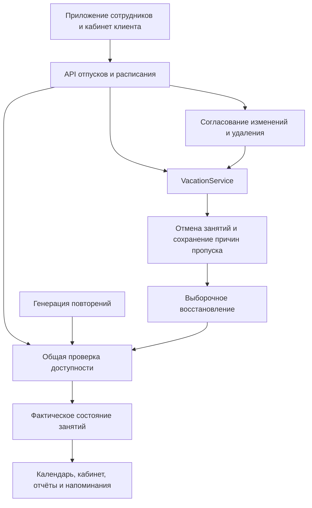

# Централизованное расписание и отпуска

Рабочие правила согласованы 5 октября 2026 года. Предыдущее состояние и обнаруженные расхождения описаны в [аудите](scheduling-consistency-audit.md). Этот документ описывает новую реализацию.

## Отпуск и согласование

У клиента и сотрудника одна сущность `Vacation`. Владелец задаётся ровно одним из `ClientId` / `UserId`. Идентификатор сохраняется при изменении; `Version` защищает операции и решения по заявкам от устаревших данных.

| Действие | Клиент / преподаватель / администратор для себя | Суперпользователь |
| --- | --- | --- |
| Создать отпуск | Заявка | Сразу |
| Изменить даты | Заявка с ID и ожидаемой версией отпуска | Сразу с ожидаемой версией |
| Удалить отпуск | Заявка с ID и ожидаемой версией | Сразу |
| Завершить текущий отпуск | Сразу | Сразу |
| Восстановить занятия | Явный выбор и повторная проверка доступности | Аналогично |

Одобрение заявки вызывает ту же операцию изменения отпуска, что и прямое управление. Отпуск не изменяется до решения. Если за время согласования изменилась его версия, решение отклоняется с конфликтом. Отмену пересекающихся `Planned` необходимо явно разрешить; `Completed`, `Burned` и ручные отмены сохраняются.

Будущий удалённый отпуск помечается отменённым и перестаёт блокировать доступность. Удаление текущего отпуска и досрочное завершение сохраняют фактический период до момента операции. Завершение дополнительно сохраняет первоначальную дату окончания. Историческую часть отпуска нельзя переписать редактированием.

## Единая проверка доступности

`SchedulingAvailability` в Core задаёт правила интервала. `SchedulingAvailabilityService` загружает отпуска, график и занятость; проверяет существующие занятия и ещё не материализованные повторения. Общую проверку используют ручное создание, перенос, возвращение в `Planned`, перенос серии и восстановление. Материализатор использует те же правила над загруженным графом.

Интервалы полуоткрытые: `[начало, окончание)`. Соседние отпуск / занятие не пересекаются. Проверяются отпуск клиента, отпуск преподавателя, его местный день недели и рабочие часы, а также занятость обоих участников. Отсутствующий рабочий день считается недоступным. Окончание занятия за границей графика даже на секунду отклоняется.

Изменение рабочих часов тоже проходит общую операцию: будущие `Planned`, которые не помещаются в новый график, требуют явного разрешения отмены. Одобренные изменения записывают активность владельца, поэтому прежний снимок формы не может незаметно затереть согласованный график.

Операции изменения расписания и материализации берут одну транзакционную PostgreSQL advisory-блокировку `41051` до чтения изменяемого состояния. Сохранение занятий, причин отмены и аудита происходит атомарно.

## Причины пропуска и восстановление

`SchedulingInterruption` хранит связь с отпуском и занятием либо правилом и номером вхождения. При создании / расширении отпуска фиксируются и реальные отменённые занятия, и ещё не созданные будущие вхождения на всём интервале отпуска. Поэтому сокращение отпуска не приводит к автоматическому появлению занятия при следующем открытии календаря.

После сокращения, удаления или завершения отпуск можно открыть в управлении и запросить список будущих занятий. Для каждого выводятся доступность и причины блокировки. Восстановление повторно проверяет версию отпуска, доступность и пересечения выбранных занятий внутри одной транзакции. Выбранные вхождения становятся `Planned`; остальные остаются отменёнными / пропущенными.

Удалённые экземпляры, ручные отмены, состоявшиеся занятия и отмены по другим причинам нельзя восстановить как последствия отпуска. Последующая ручная смена статуса закрывает старое предложение восстановления.

## Часовые пояса и повторения

`User.ScheduleTimezone` — явный IANA-пояс преподавателя. Формы времени и рабочего графика используют этот пояс. Периоды отпусков и реальные занятия передаются и сохраняются в UTC. Для клиента без собственного графика форма отпуска использует пояс устройства.

Новое правило повторения сохраняет собственный `Timezone` и длительность. Недельный / месячный паттерн относится к местной дате правила; генератор переводит каждое вхождение в UTC отдельно. При переходе на летнее время сохраняется местное время начала и реальная длительность. Несуществующий местный час пропускается; из двух неоднозначных часов форма и сервер выбирают более поздний момент UTC. Форма отклоняет несуществующий час.

Рабочая ёмкость и доступность используют реально существующие минуты местного рабочего интервала. Несуществующая граница сдвигается до первой существующей минуты. Если короткий рабочий интервал повторился при переводе часов назад, это два отдельных окна; занятие не может пересечь нерабочий промежуток между ними. Окончание ровно в `24:00` допускается при такой границе графика.

Существующие правила сохраняют UTC-семантику при миграции, чтобы не сдвинуть историческое и уже запланированное расписание. Явный перенос будущей части серии переводит её в актуальный пояс преподавателя.

Вхождение имеет устойчивую пару `(RecurringRuleId, RecurrenceOrdinal)`: для ежедневного / недельного правила номер соответствует смещению местной даты в днях, для месячного — в месяцах. Отсутствующий день месяца не перенумеровывает последующие вхождения. Удалённые экземпляры тоже занимают свою пару.

Перенос и удаление серии действуют на будущую часть. История и состояния `Completed` / `Burned` сохраняются. Перенос создаёт продолжение правила, переносит реальные экземпляры, удаления и причины пропуска с прежними состояниями, проверяет все переносимые `Planned`. Незатронутые нематериализованные даты проверяются при дальнейшей генерации.

Изменение типа или паттерна существующего правила через PATCH отдельного занятия отклоняется: такой запрос мог переписать историю и устойчивые номера всей серии. Для нового паттерна нужно завершить будущую часть и создать новую серию. Повторная передача прежнего паттерна не изменяет правило.

## Отображение и отчёты

Календарь, кабинет, дашборд, ICS, напоминания и отчёты читают фактическое состояние занятия. Дополнительного сокрытия состоявшихся занятий по отпуску нет. Отмена из-за отпуска видна в штатном статусе, а пропущенное вхождение появляется только после явного восстановления.

Рабочая ёмкость отчёта строится по поясу преподавателя, обрезается до периода отчёта и уменьшается на фактические интервалы отпуска. Использование текущего недельного графика для исторической ёмкости остаётся существующей семантикой отчёта. При подсчёте дней неактивности исключаются только полностью покрытые отпуском местные дни.

Напоминания о занятиях следуют их состояниям. Правила контактов с клиентом продолжают учитывать отпуск в момент обращения; для отложенной задачи — в момент запланированного обращения. Это отличается от доступности самого занятия по назначению правила.

Изменения отпусков / графика обновляют связанные запросы TanStack Query: отпуска, заявки, доступность, занятия, клиентский кабинет, дашборды, отчёты, задачи и аудит. Управление отдельными отпусками доступно в staff-приложении и клиентском кабинете. Старый сохранённый черновик списка отпусков клиента доступен для восстановления; обычное управление использует отдельные операции.

## Миграция и проверки

Миграция объединяет две таблицы отпусков, сохраняя их идентификаторы, владельцев и UTC-периоды. Добавляет версии, состояния жизненного цикла, пояс пользователя / правила, устойчивые номера вхождений и причины отмены. Старые ручные `Cancelled` не получают придуманную причину отпуска.

Для существующих преподавателей и заявок на график начальный пояс — `Europe/Moscow`, для старых повторений — `UTC`, длительность — 60 минут. Преподаватель может изменить пояс в профиле. При переносе данных некорректный старый период с окончанием не позже начала сохраняется как отменённая запись: исходное окончание остаётся в `OriginalEndDate`, техническое — начало плюс микросекунда. Дубли вхождений сохраняются как самостоятельные занятия; история не удаляется. Повреждённая ссылка старой заявки на отпуск восстанавливается по владельцу и точному периоду либо очищается.

Обратная миграция переносит действующие фактические периоды в прежние таблицы и отменяет необработанные заявки на редактирование / удаление, которых старая версия не понимает. Если появились правила в локальном поясе, откат отклоняется: сначала требуется явное преобразование таких правил в UTC, иначе старая версия сдвинет расписание.

Миграция создаётся штатным EF-инструментом; designer и snapshot не редактируются вручную. Перенос данных и обратный переход проверяются отдельно. Рабочую базу изменяет существующий Init-процесс, не API startup.

Сценарии проверки: границы интервалов, оба владельца отпуска, смена местной даты / DST, устаревшие решения, сохранение ID, атомарная отмена и выборочное восстановление, пропуски вне ранее открытых недель, история / исключения серии, доступность виртуальных повторений, договорённость API и поведение обоих интерфейсов.

Итоговый `dotnet build MelodyTrack.slnx` прошёл без предупреждений и ошибок. Полный backend-прогон: 493 теста, все прошли; тесты генератора API: 11, все прошли. PostgreSQL-тест миграции проверяет сохранение ID / владельцев, перенос вхождений, разграничение ручных отмен и отмен из-за отпуска, подавление ещё не материализованных повторений и обратный переход.

Фронтенд прошёл полный `npm run verify:fix`: форматирование, Biome, ESLint, архитектура, ассеты, CSS-совместимость, граница копирования URL, TypeScript, 285 unit-тестов, 107 сценариев Chromium, сборка и бюджет бандла, 107 сценариев WebKit. В каждом браузере один взаимоисключающий сценарий записи WebM пропускается по фактической поддержке: Chromium проверяет запись, WebKit — объяснение недоступности. Остались 12 предупреждений Biome и 4 предупреждения ESLint в существующих стилях / коде тренажёра и общей кнопке; ошибок нет. Автоматические изменения форматирования и lint-fix просмотрены, скриншоты упавших промежуточных прогонов удалены из изменений.

API-клиент Kiota и EF designer / snapshot сгенерированы штатными инструментами. `dotnet ef migrations has-pending-model-changes` подтвердил отсутствие расхождений модели и миграции. Миграция проверяется в PostgreSQL Testcontainer; к рабочей базе в этой задаче не применялась.
