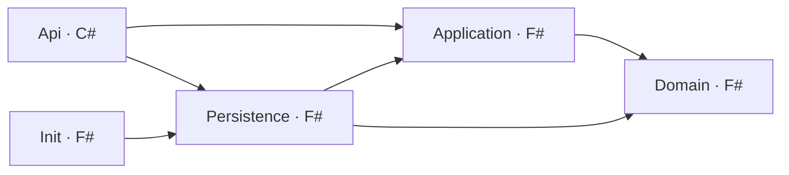

# Архитектура новой версии

Статус: рабочий документ. Подтверждены разработка с нуля, собственный runner в Init, единый production host, единый часовой пояс Europe/Moscow и граница языков: F# — предметная/прикладная логика и БД, C# — Web API D-380. TickerQ исключён; выбран Quartz.NET с PostgreSQL/Npgsql без EF Core D-381. Каркас пяти проектов, зависимости и границы данных/транзакций согласованы D-382. По отдельному запросу D-390 создан изолированный пустой каркас в rewrite/; предметная реализация ещё не создана. Исходная работающая версия сохраняется.

Источник направления: архитектурный набросок пользователя «MelodyTrack rewrite — architecture direction», предоставленный 14 октября 2026 года. Решения фиксируются в [журнале](decisions.md), продуктовые правила — в остальных разделах спецификации.

## Подтверждено

| ID | Решение | Основание |
| --- | --- | --- |
| ARCH-001 | Новая реализация сразу пишется с нуля на целевом стеке; постепенная смена технологий через промежуточные реализации не требуется | D-125 |
| ARCH-002 | SQL-миграции выполняет собственный runner внутри отдельного Init | D-126 |
| ARCH-003 | Production React и API обслуживает один ASP.NET Core host под одним адресом | D-127 |
| ARCH-004 | Новая БД с переносом либо преобразование старой на месте выбираются после оценки новой схемы | D-128 |
| ARCH-005 | Фоновые запуски: Quartz.NET внутри host с PostgreSQL-хранилищем через Npgsql/ADO.NET, без EF Core; TickerQ исключён | D-132, D-381 |
| ARCH-006 | Единый фиксированный Europe/Moscow для всех; отдельные зоны преподавателей не требуются | D-141 отменяет D-130 |
| ARCH-007 | Все абсолютные отметки времени хранятся и передаются в UTC; клиент преобразует их для отображения | D-133 |
| ARCH-008 | Бэкенд сначала полностью проектируем и согласуем; пользователь пишет его реализацию, ассистент ревьюит и подсказывает. Фронтенд проектирует и реализует ассистент по требованиям и согласованному дизайну | D-135, уточнено D-223 |
| ARCH-009 | Идентификаторы новой версии — UUIDv7 | D-136 |
| ARCH-010 | Production: один Linux-сервер, Docker Compose | D-339 |
| ARCH-011 | Для предрелизной проверки достаточно локального окружения; отдельный стенд не нужен | D-340 |
| ARCH-012 | Допустимая потеря последних изменений при аварии — не более суток | D-341 |
| ARCH-013 | Целевое восстановление работоспособности после аварии — за сутки | D-343 |
| ARCH-014 | Обновления вне рабочих часов с плановым перерывом примерно 5–10 минут | D-344 |
| ARCH-015 | F#: доменная модель, бизнес-логика, прикладные операции, работа с БД; C#: Web API/host и HTTP-адаптация | D-380 |
| ARCH-016 | Согласованы пять проектов, зависимости, узкие прикладные порты, гибрид SqlHydra/Npgsql и транзакционная граница Application | D-382 |
| ARCH-017 | Создан пустой каркас в rewrite/: отдельная solution, уникальные имена MelodyTrack.Rewrite.*, независимые настройки SDK/CPM/сборки; старая solution не меняется | D-390 |

Изучение F# включено в работу D-124. Исходный код пока сохранён как источник поведения; новая реализация не должна наследовать его структуру ради совместимости. Данные и подтверждённые пользовательские сценарии сохраняются через явно описанный перенос.

## Граница F# и C# — D-380

F# реализует доменную модель, предметные правила/расчёты, прикладные операции, запросы и запись в БД, транзакции, Init и предметную работу фоновых обработчиков. C# содержит Web API/host: маршруты, HTTP-модели, привязку запроса, интеграцию аутентификации, отображение результата/ошибки в HTTP и регистрацию компонентов. Прикладная проверка прав на конкретные данные остаётся в F# вместе с инвариантами.

Предлагаемое взаимодействие: C# endpoint переводит вход в команду/запрос F# и отображает его результат в ответ. Слой F# не зависит от HttpContext/HTTP DTO. Фоновый вызов использует те же прикладные операции F#, сохраняя общие предметные проверки. Конкретные типы межъязыковой границы, раскладка проектов и библиотеки ещё проектируются; D-380 не утверждает весь набор технологий наброска автоматически.

## Направление исходного наброска

Ниже перечислено предложение пользователя; выбранные детали отмечены отдельно в таблице выше.

- Backend: .NET 10+, C# Minimal API shell, F# Application/Domain/Persistence/Init, PostgreSQL, SqlHydra и непосредственный SQL/Npgsql.
- API-контракт: OpenAPI и генерируемый Kiota TypeScript-клиент.
- Frontend: React, TypeScript, Vite, Ant Design, TanStack Query, FSD; Tiptap для структурированных документов.
- Разработка: Aspire. Production: Compose, PostgreSQL, одноразовый Init и единое приложение; начальная наблюдаемость через OpenTelemetry/Seq.
- Пять backend-проектов: Api, Application, Domain, Persistence, Init; организация по возможностям внутри каждого.
- Чистые предметные функции, время передаётся явно; применение DDD только для реальных инвариантов и переходов.
- Application координирует операции и транзакции, Persistence реализует необходимые порты; сгенерированные записи БД остаются внутри Persistence.
- Команды/запросы работают с одной БД; собственные шины команд, универсальные repositories и event sourcing не являются исходными требованиями.

## Согласованный каркас бэкенда — D-382

Основание — исходный архитектурный набросок пользователя, D-380/D-381 и подтверждение каркаса D-382. Q-361 закрыт. Конкретные типы, SQL-схема и API далее проектируются отдельно. Исходные проекты не переименовываются. По D-390 создан только изолированный пустой каркас; предметная реализация не добавляется.

| Проект | Язык | Ответственность |
| --- | --- | --- |
| MelodyTrack.Domain | F# | Предметные состояния, инварианты и расчёты. Зависимостей от остальных проектов, HTTP, БД и планировщика нет; время передаётся явно |
| MelodyTrack.Application | F# | Прикладные команды/запросы, проверка доступа к данным, координация операции и её транзакционной границы. Узкие порты по потребности сценария; C#-совместимый вход/результат |
| MelodyTrack.Persistence | F# | SQL-запросы, SqlHydra/Npgsql, преобразование строк БД, реализация прикладных портов и транзакционной сессии |
| MelodyTrack.Api | C# | Web API и host: HTTP DTO, маршруты, подключение аутентификации/компонентов, преобразование вызова/результата F#, регистрация Quartz |
| MelodyTrack.Init | F# | Одноразовое применение SQL-миграций, требуемые начальные данные и версионные преобразования; запускается до приложения |

Физическое размещение по D-390: [rewrite/MelodyTrack.Rewrite.slnx](../rewrite/MelodyTrack.Rewrite.slnx), проекты в rewrite/src/MelodyTrack.Rewrite.*. В таблице выше сохранены логические имена ролей проектов; префикс Rewrite отличает новые проекты/сборки от исходных, прежде всего старого MelodyTrack.Init. Подробности — [README каркаса](../rewrite/README.md).

Стрелка означает ссылку проекта при компиляции:

Ссылка Api на Persistence используется для сборки зависимостей; endpoint вызывает прикладную операцию Application. Init использует инфраструктуру подключения/миграций, а исторические преобразования не вызывают текущую изменяемую логику Domain/Application. Внешние типы БД не выходят из Persistence.

Внутри проектов код группируется по возможностям: Clients, Scheduling/Vacations, Finance, Courses/Practice, Tasks, Auth и PublicSite по мере реального состава. Простой CRUD не требует отдельного агрегата, фабрики или универсального repository. Границы модулей не создают отдельных deployable-сервисов.

Согласованный доступ к данным сохраняет исходный гибрид пользователя: SqlHydra для сгенерированных типов и обычных понятных запросов; Npgsql + HydraReader/raw SQL для запросов, где прямой SQL яснее. [SqlHydra](https://github.com/JordanMarr/SqlHydra) поддерживает генерацию по схеме и библиотеку запросов; [Npgsql](https://www.npgsql.org/doc/basic-usage.html) предоставляет явные подключения/транзакции. Это не выбор схемы БД по классам домена и не требование пропускать любой SQL через единый DSL.

Согласованная граница операции: Application координирует одну команду; Persistence даёт одну явную SQL-сессию/транзакцию на связанные чтения и записи. Domain вычисляет переход без знания о транзакции. Например, создание занятия проверяет предметные условия и сохраняет запись/аудит согласованно. Защита от конкурентного обхода пересечений задаётся ограничениями/блокировками при проектировании схемы, а не одной лишь последовательностью предварительных проверок.

Для чтения Application может возвращать специализированную проекцию Persistence без создания полного доменного объекта. Для изменений используются общие предметные правила. HTTP-контракт, прикладные типы и сгенерированные строки таблиц остаются разными представлениями своих границ; конкретные формы Result/ошибок и DTO будут показаны на сценариях, без нового универсального фреймворка.

Дальнейшая проработка: сначала связанные сущности и инварианты, затем таблицы/ограничения и API операций, с примерами создания/переноса занятия, отметки результата, покупки/возврата денег и изменения отпуска. Для первичного разбора подходит связка «клиент — услуга — преподаватель — занятие — серия — исключение — отпуск/график». Неизвестные правила заказчика помечаются открытыми и не заполняются догадкой.

Выбор первого релиза D-005 и способа переноса БД D-128 остаются в ранее установленном порядке. Согласование каркаса не утверждает конкретные версии пакетов, SQL-миграции или API в исходном коде.

## Производные данные

По D-154 исходные факты и настройки служат источником вычисляемых показателей. Текущий XP прохождения курса вычисляется по статусам тем, отдельный накопленный остаток не хранится. Для других показателей при проектировании также сначала проверяется возможность вычисления, чтобы избежать нескольких независимо обновляемых копий одного значения.

Денежный баланс клиента также вычисляемый D-190; независимо изменяемый остаток не хранится. Этот выбор не утверждает отдельный ledger или таблицу начислений. По D-192 новая цена не вводится с началом действия в прошлом и не меняет стоимость уже прошедших уроков. При проектировании следует рассмотреть вычисление цены по сохраняемой истории действия цен; отдельная сохранённая стоимость каждого занятия этим правилом не предписывается. Детальная модель первичных финансовых данных ещё согласуется.

По D-301 остаток абонемента также вычисляемый: выданные 4/8 занятий минус действующие проведённые/сгоревшие встречи, оплаченные им. Выбранное покрытие конкретной встречи — сохраняемый исходный факт для локальности исправлений D-296. Истечение срока ограничивает использование по времени без уничтожения исходных данных. По D-305 нужно сохранять и факт прошлого использования: снятие всех результатов восстанавливает вычисляемый остаток, но не разрешает отмену покупки. Схема таблиц/связей ещё проектируется; отдельный независимо обновляемый остаток не требуется. Месячный срок с покупки, согласованные продления и ограничения количества сохраняются; подробнее — в subscriptions.md.

Это не означает удаление исторических фактов или требование вычислять всё из сегодняшних настроек. Например, подтверждённое завершение курса должно сохраняться при добавлении новой темы D-147; одного сравнения текущих освоенных тем со всей изменённой программой для этого недостаточно. Конкретная модель таких фактов проектируется отдельно. Материализация ради производительности требует отдельного обоснования, а не предполагается по умолчанию.

## Init и собственный runner

По D-126 выбран собственный runner с требованиями исходного наброска:

1. Упорядоченные миграции с однозначной версией.
2. История применённых миграций и проверка checksum SQL.
3. PostgreSQL advisory locking для исключения одновременного обновления.
4. Транзакционное выполнение там, где операции PostgreSQL это допускают.
5. Отмена, понятное сообщение об ошибке и ненулевой код завершения при неудаче.
6. Неизменность выпущенных миграций.

Исходное направление: Init выполняется перед приложением; приложение запускается после успешного завершения Init. Приложение не выполняет миграции самостоятельно при старте. SQL — исходник схемы; SqlHydra генерирует записи по полученной схеме.

Для сложных преобразований предложены версионные F# hooks. Они не должны вызывать текущую изменяемую предметную логику. Дополнение к оценке: исторические преобразования также следует изолировать от текущих сгенерированных типов БД, сохранять сведения об их версии и описать восстановление после прерванного выполнения. Формат регистрации hooks, история и способ проверки их неизменности ещё проектируются.

Способ перехода со старой EF-схемы пока открыт D-128. Нужно отдельно проверить свежую установку и обновление существующих данных; успешная генерация схемы из пустой БД не подтверждает корректность переноса. Подробности — [перенос](migration-and-acceptance.md).

## Единый production host

По D-127 React-сборка входит в поставку ASP.NET Core приложения. UI и API доступны под одним адресом. Это решение о production; способы запуска Vite/Aspire для разработки уточняются отдельно.

Требования к маршрутам: API-запрос не должен получать SPA HTML, неизвестный API-маршрут остаётся API-ошибкой, переход на маршрут интерфейса должен открывать нужный экран. Health, OpenAPI и аварийный доступ не смешиваются с SPA fallback. Изоляция «Режима Бога» по [аутентификации](authentication.md) сохраняется.

Конкретные пути маршрутов, сборка frontend-ассетов, reverse proxy, HTTPS и схема запуска Compose ещё проектируются. Решение об одном host не создаёт новый отдельный frontend-сервис production.

## Время

По D-133 абсолютные моменты во всех подсистемах сохраняются в UTC и передаются API в UTC. Для текстового представления используется ISO 8601 с суффиксом `Z`. Преобразование для отображения и обратное преобразование введённого пользователем времени выполняет клиент. Это общее правило для расписания, отпусков, финансов, сроков доступа и аудита, а не настройка отдельного экрана.

По D-141 для всей системы используется единый фиксированный Europe/Moscow: расписание, еженедельные правила, начало целого часа, календарные задачи, месячные сроки абонементов и отчётные периоды. Клиент преобразует UTC в Europe/Moscow для отображения независимо от зоны устройства. Отдельные зоны преподавателей и выбор зоны пользователем не требуются; прежнее решение D-130 отменено ради упрощения.

Календарная дата без времени (например, дата рождения) не является отметкой времени и не превращается в полночь UTC. Еженедельное правило задаётся по московским дням и часам; конкретные встречи рассчитываются сервером и сохраняются в UTC. Дополнительная зона в каждой серии не нужна.

## Открытые архитектурные вопросы

- Выбор планировщика Q-130/Q-138 закрыт D-381: Quartz.NET с PostgreSQL/Npgsql без EF Core. Остаются конкретная версия, схема технического хранилища и контракты запуска/повторов.
- UUIDv7 выбран D-136; сопоставление старых идентификаторов при переносе ещё описывается.
- Q-133: объём офлайн-операций и синхронизация отложен до обсуждения пользователя с заказчиком D-134. Архитектура офлайн-изменений пока не выбирается.

## Планировщик — D-381

TickerQ был рассмотрен и исключён D-132. Его [документация](https://tickerq.net/docs/what-is-tickerq) описывает память, SQL через EF Core и Redis; отказ пользователя относится к соответствию нашей архитектуре, а не к утверждению, что библиотека вообще не работает без EF Core.

По D-381 выбран Quartz.NET внутри приложения с PostgreSQL ADO.NET-хранилищем через Npgsql, без EF Core. Предметные обработчики и прикладные операции остаются в F# D-380; C# host подключает компоненты. [Документация Quartz](https://www.quartz-scheduler.net/documentation/quartz-3.x/tutorial/job-stores.html) описывает такое хранилище без EF Core. Конкретная версия, таблицы и интеграция ещё выбираются; схема хранилища должна управляться Init, а предметные серии и правила задач остаются частью нашей модели. Нужно описать восстановление, повторы и идемпотентность бизнес-операций; надёжность запуска планировщика не заменяет эти правила.

### Альтернативы без EF Core — обсуждение 15.10, сверка 27.10.2026

Все перечисленные подходы позволяют обойтись без EF Core. Наличие SQL-хранилища у планировщика и возможность прикладного обработчика читать нашу БД — разные свойства. Прикладная работа с БД остаётся в F# по D-380.

ADO.NET — интерфейсы доступа к БД; [Npgsql](https://www.npgsql.org/) сам является современным ADO.NET-провайдером PostgreSQL, отдельным от его EF Core provider. [Прямые SQL-запросы, асинхронные операции и транзакции](https://www.npgsql.org/doc/basic-usage.html) доступны без ORM. Упоминание ADO.NET у Quartz не требует DataSet/DataAdapter или старой архитектуры приложения.

| Вариант | Состояние в БД без EF Core | Возможности и пределы | Оценка для MelodyTrack |
| --- | --- | --- | --- |
| [Quartz.NET](https://www.quartz-scheduler.net/documentation/quartz-4.x/tutorial/job-stores.html) | AdoJobStore с PostgreSQL/Npgsql | Сохраняемые задания/триггеры, управление расписаниями; таблицы планировщика отдельны от предметных данных | Выбран пользователем D-381 для технических фоновых запусков |
| [Hangfire](https://www.hangfire.io/overview) + [Hangfire.PostgreSql](https://github.com/hangfire-postgres/Hangfire.PostgreSql) | PostgreSQL provider использует Npgsql, EF Core не нужен | Сохраняемая очередь, отложенные/повторяющиеся работы, автоматические повторы, технический dashboard. PostgreSQL provider поддерживается сообществом, не основной командой Hangfire | Альтернатива при приоритете очереди работ, повторов и готового операционного интерфейса |
| [Coravel](https://docs.coravel.net/Scheduler/) | Базовый scheduler/queue не предоставляет сохраняемую PostgreSQL-очередь | Простой запуск обработчиков; [базовая очередь в памяти](https://docs.coravel.net/Queuing/). Вызванный обработчик может использовать наш SQL-доступ | Подходит как простой технический таймер; сохраняемое состояние и восстановление предметной работы потребуются в нашей модели |
| [Wolverine](https://wolverinefx.net/guide/durability/postgresql.html) | Отдельное PostgreSQL-хранилище сообщений без обязательного EF Core | Сохраняемые сообщения, inbox/outbox, повторная/отложенная обработка. Есть [поддержка F# и генерация адаптеров](https://wolverinefx.io/tutorials/fsharp.html) | Более широкий messaging framework; выбор требует осознанно принять его модель обработки, а не подключить только ради таймера |
| [BackgroundService](https://learn.microsoft.com/en-us/aspnet/core/fundamentals/host/hosted-services?view=aspnetcore-10.0) + Npgsql/наша SQL-модель | Подключение и хранение состояния реализуем сами | Встроенный жизненный цикл фонового процесса и таймер/цикл; готовой сохраняемой очереди, retry-политики и восстановления не даёт | Минимум внешних библиотек, больше собственной инфраструктурной реализации |

После сравнения пользователь выбрал Quartz.NET D-381; Q-130/Q-138 закрыты. Таблица сохраняет основания выбора и рассмотренные альтернативы, а не несколько одновременно выбранных механизмов. Конкретная версия Quartz ещё не выбрана. У Coravel/BackgroundService самостоятельная работа по сохранению/восстановлению существенно больше.

Предложение по упрощению: предметные серии занятий, правила задач ресепшена и факты выполненной обработки хранятся в нашей модели. Планировщик запускает небольшой набор обработчиков F#, которые находят актуальную работу и безопасно повторяют незавершённую. Выбор библиотеки не заменяет идемпотентность и общие транзакционные правила. Отдельная очередь/worker-процесс, универсальная шина и по одному библиотечному trigger на каждую встречу не утверждены.

Техническая схема Quartz управляется через Init; конкретные SQL-миграции, связь запуска с прикладной транзакцией и возобновление после перезапуска ещё проектируются. Выбор библиотеки не разрешает автоматически менять схему при старте Web API. Пакеты и исходный код в текущем обсуждении не изменяются.

Для последующего проектирования возможностей:

- Прописать допустимые зависимости проектов и небольшой C#-совместимый фасад.
- Обеспечить общую транзакцию SQL/Npgsql/SqlHydra для одной команды.
- Определить целостность значимых команд и защиту от случайных повторов. По D-239 разные пользователи могут работать параллельно, глобальной блокировки входов нет. Специальный интерфейс совместного редактирования и сверки правок не требуется D-234, D-239. Предметные ограничения сохраняются; обязательная модель версий каждой записи и синхронизация интерфейсов в реальном времени не выбраны.
- Сохранить единое определение вычисляемых состояний, начислений и доступности в карточках, фильтрах и отчётах.
- Описать фоновые операции, повторы и надёжную доставку внешних эффектов после commit.
- Разделить прикладной аудит в БД и диагностическую телеметрию.
- Проверять принадлежность данных/разрешение операции в сценариях Application, дополнительно к HTTP-проверке входа и роли.

Это направления дальнейшей детализации. Схема БД, библиотечные версии, код и проверочные конвейеры новой реализации пока не созданы.

## Эксплуатационные требования — D-339–D-348

Подтверждены один Linux-сервер с Docker Compose и локальное окружение для предрелизной проверки. Отдельный тестовый стенд не требуется. Production frontend/API обслуживает один ASP.NET Core host D-127. Обновления допустимы вне рабочих часов с перерывом примерно 5–10 минут.

Резервные копии создаются ежедневно на основном сервере и хранятся семь дней D-345–D-346. Внешнее место резервирования не организуется; оповещения о сбоях или отсутствии свежей копии не требуются D-347. Конкретный инструмент и процедура резервирования ещё выбираются.

Целевые пределы: потеря последних изменений не более 24 часов D-341 и восстановление работоспособности за 24 часа D-343. Выполнение целей ещё не проверено. При выбранном локальном резервировании они применимы к случаям с сохранившейся пригодной копией и необходимыми конфигурацией/ключевым материалом. Потеря самого сервера вместе с его копиями этим планом не покрывается.

После восстановления не выполняется обязательный массовый сброс сессий сотрудников, клиентских ссылок и календарных подписок D-348. Доступы сохраняются, если нет конкретной причины для их отзыва. Если откат возвращает ранее отозванный доступ, необходимый сброс ограничивается затронутыми доступами, насколько это позволяет установить сохранившаяся информация. Восстановление утраченных сведений об отзывах не считается обеспеченным самим резервированием. Конкретная процедура должна учитывать это ограничение; отдельный сервис хранения отзывов не утверждён.

Аварийный предел потери данных не применяется к плановому переходу на новую версию: исходная история сохраняется по правилам миграции. Способ переноса Q-128 отложен до оценки целевой схемы. Эти требования не разрешают сейчас запускать сборки, тесты или развёртывание.
