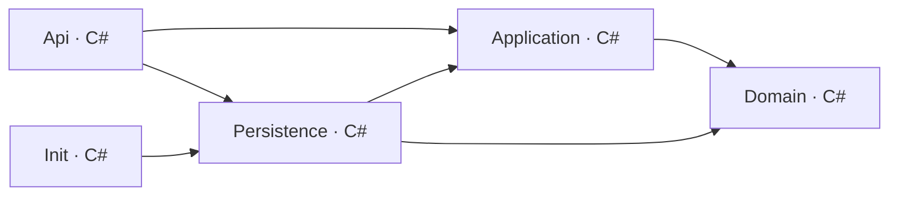

# Архитектура новой версии

Актуальное описание C# rewrite после сверки D-455. Исторический набросок F#/SqlHydra и старые решения D-380/D-393/D-394 сохранены в журнале, но не требуют возвращать прежний язык, runtime-поиск миграций или ручную регистрацию.

Статус реализации: основные проекты уже содержат Domain/Rules, Application и инфраструктуру SQL/Init, первый блок клиентов/импорта и API-адаптацию ошибок. Это не готовый API всех предметных команд. Состояние конкретных проверок — в README и документах блоков; наличие кода не доказывает его проверенность. Текущий TargetFramework в `rewrite/Directory.Build.props` — net11.0; старые сведения о .NET 10 исходного приложения не подменяют настройки rewrite.

## Подтверждённые решения

| ID | Решение | Основание |
| --- | --- | --- |
| ARCH-001 | Новая реализация сразу пишется с нуля на целевом стеке; постепенная смена технологий через промежуточные реализации не требуется | D-125 |
| ARCH-002 | SQL-миграции выполняет собственный runner внутри отдельного Init | D-126 |
| ARCH-003 | Production React и API обслуживает один ASP.NET Core host под одним адресом | D-127 |
| ARCH-004 | Перенос в отдельную целевую БД с пробным переносом и сверкой; исходная база сохраняется. Целевая основная версия PostgreSQL — 17 | D-397–D-398 уточняют D-128 |
| ARCH-005 | Фоновые запуски: Quartz.NET внутри host с PostgreSQL-хранилищем через Npgsql/ADO.NET, без EF Core; TickerQ исключён | D-132, D-381 |
| ARCH-006 | Единый фиксированный Europe/Moscow для всех; отдельные зоны преподавателей не требуются | D-141 отменяет D-130 |
| ARCH-007 | Все абсолютные отметки времени хранятся и передаются в UTC; клиент преобразует их для отображения | D-133 |
| ARCH-008 | Ассистент реализует бэкенд небольшими порциями с остановкой после каждого шага для ручного ревью пользователем. Предметные правила согласуются до реализации. Фронтенд также реализует ассистент | D-391 изменяет распределение D-135/D-223 |
| ARCH-009 | Идентификаторы новой версии — UUIDv7 | D-136 |
| ARCH-010 | Production: один Linux-сервер, Docker Compose | D-339 |
| ARCH-011 | Для предрелизной проверки достаточно локального окружения; отдельный стенд не нужен | D-340 |
| ARCH-012 | Допустимая потеря последних изменений при аварии — не более суток | D-341 |
| ARCH-013 | Целевое восстановление работоспособности после аварии — за сутки | D-343 |
| ARCH-014 | Обновления вне рабочих часов с плановым перерывом примерно 5–10 минут | D-344 |
| ARCH-015 | Текущие Domain/Application/Persistence/Init/Api написаны на C#; данные сущностей отделены от Rules и прикладной авторизации | D-455; актуальная карта моделей |
| ARCH-016 | Пять основных проектов, узкие прикладные порты и транзакционная граница Application; текущий SQL-доступ Npgsql/Dapper | D-382, актуализировано D-455 |
| ARCH-017 | Изолированный rewrite с предметными моделями/Rules, прикладными операциями в памяти, Init и первым блоком хранения/импорта клиентов; проверенность описывается отдельно | D-390/D-391/D-455; README rewrite |

## Проекты и зависимости

| Проект rewrite | Язык | Ответственность |
| --- | --- | --- |
| Domain | C# | Данные сущностей, типизированные ID/значения и чистые предметные Rules; без HTTP, БД и планировщика |
| Application | C# | Авторизация, команды/запросы, координация и транзакционная граница; узкие порты по реальным сценариям |
| Persistence | C# | Npgsql/Dapper, явный SQL и отображения PostgreSQL enum, подключение и транзакции, проекции/реализации портов |
| Api | C# | Minimal API/host, HTTP DTO и отображение Result в HTTP, регистрация компонентов |
| Init | C# | Одноразовые SQL/C#-миграции, требуемая инициализация и явные операции импорта; до API |

Основная solution — `rewrite/MelodyTrack.Rewrite.slnx`; тестовые проекты отдельны от пяти основных. Имена сборок MelodyTrack.Rewrite.* не конфликтуют с исходной версией. Проекты исходного приложения не переименовываются.

Api ссылается на Persistence для сборки зависимостей; endpoint вызывает Application. Данные сущностей отделены от переходов в Domain/Rules; авторизация — в Application/Operations. Объекты значений сохраняют локальную проверку. Время передаётся явно; CSharpFunctionalExtensions Result/UnitResult и категории OperationError не зависят от HTTP. Форма HTTP-ошибки/DTO определяется API. Универсальные command bus, repositories и event sourcing не требуются.

## SQL и граница операции

Текущий доступ — Npgsql и Dapper с параметризованным SQL, неизменяемыми объектами запросов и явной транзакцией; см. [описание rewrite](../rewrite/README.md). Долгоживущим NpgsqlDataSource владеет host, отдельное соединение между запросами не разделяется. Проекции строк и типы БД не становятся доменными сущностями автоматически. SqlHydra относится к прежнему направлению, не к требованию новой реализации.

Application координирует связанную команду, Persistence даёт явное подключение/транзакцию, Domain вычисляет переход без знания БД. Ограничения/индексы и короткие адресные блокировки защищают инварианты D-400. Изменение, аудит и последующая работа атомарны, повторы имеют постоянные ключи D-401. Нет глобальной блокировки школы или обязательной версии каждой записи без конкретного основания.

## Init и миграции

Init выполняется до приложения; API не меняет схему при старте. Миграции SQL/C# лежат в Migrations с общей последовательностью номеров. Генератор при сборке создаёт единый реестр и SHA-256 исходных байтов; runtime-поиска, рефлексии и ручной регистрации нет. Скопированные исходники предназначены для просмотра, редактирование их после сборки не меняет исполнение. Подробности — [контракт миграций](../rewrite/src/MelodyTrack.Rewrite.Init/Migrations/README.md).

MigrationContext даёт подключение, текущую транзакцию, отмену и логгер. Runner владеет транзакцией/соединением, берёт advisory lock, сверяет неизменность выпущенных шагов и атомарно записывает успешный шаг с историей. Сбой откатывает незавершённый шаг; предыдущие успешные сохраняются. Нетранзакционные операции пока не поддерживаются.

Checksum покрывает исходник миграции, а не внешние зависимости: принятый риск D-394 сохраняется и для C#-обработчика. Нельзя закрывать транзакцию или делать отдельный commit внутри обработчика. Ошибка даёт ненулевой выход, отмена передаётся явно; значения данных/SQL и секреты не попадают в диагностику.

## Фоновые обработчики

Quartz.NET с PostgreSQL/Npgsql без EF Core выбран D-381. Небольшое число периодических запусков обрабатывает актуальную работу порциями с сохранённой позицией D-402. Предметные серии и правила задач остаются в нашей модели; по одному библиотечному trigger на встречу, отдельная шина или worker-процесс не утверждены. Схемой Quartz управляет Init. Надёжность запуска не заменяет предметную идемпотентность.

## Офлайн, параллельная работа и права — D-449

Нужна полная работа доступной функциональности без интернета и продвинутый редактор разрешения конфликтов при синхронизации. Нельзя считать её только чтением/черновиками или ограниченным набором команд D-440. Отсрочка курсов/ДЗ D-446 сохраняется.

Локальные данные и отложенные команды принадлежат конкретному аккаунту; переключение не переносит их другому владельцу. Локальная операция не гарантирует принятия сервером: при доставке проверяются актуальные права, доступность и финансовые ограничения; конфликт показывается для явного разрешения. Протокол очереди, повторной доставки и макет редактора ещё проектируются. Совместный онлайн-редактор D-234/D-239 по-прежнему не нужен; это не запрет редактора конфликтов офлайн-команд.

Роль задаёт базовые права, личные правки пользователя имеют приоритет D-447. Токен не содержит роли/разрешений D-420; сервер проверяет актуальное состояние пользователя. Офлайн не отменяет отзыв доступа после восстановления связи и серверный запрет конфликтующей записи. Накопленные изменения сотрудника с отозванным доступом помечаются конфликтом «Доступ был отозван» D-460; автоматически не применяются. Срок автономного доступа и дальнейшее разрешение ещё не выбраны.

## Производные данные и предметная история

Баланс вычисляется по действующим исходным финансовым фактам D-190, прогноз — отдельно. Новые абонементы/пакеты не продаются D-428/D-450; старые покупки, использования и продления сохраняются при переносе. Цена прошлого не пересчитывается по сегодняшнему справочнику. Общий аудит не является источником баланса.

Курсы/ДЗ и их производные показатели отложены D-446; исходные программы, прогресс и материалы сохраняются. Для возвращения сохраняются прежние правила вычисляемого XP и исторического завершения. Материализация ради производительности не предполагается по умолчанию.

## Направления frontend и контрактов

React/TypeScript/Vite, FSD, TanStack Query, Ant Design, Tiptap и генерация TypeScript-клиента по OpenAPI/Kiota присутствовали в исходном наброске. Конкретные зависимости и контракт новой возможности описываются отдельно; редакционная сверка не устанавливает пакеты и не объявляет весь набросок реализованным.

## Документы, экспорт и сообщения

Версия схемы документов и типизированные параметры тренажёров — D-404; учебные редакторы отложены D-446. Онлайн-старт свободной практики фиксируется сервером, прерванность автоматическая D-405. По D-462 офлайн-попытки записываются без связи и синхронизируются по уникальному ключу; серверная запись старта не является предварительным условием автономной попытки. По D-466 повторная отправка K сохраняет одну попытку, разные K1/K2 сохраняются обе даже при одинаковых параметрах. Объединения по сходству нет, безопасные повторы D-401 сохраняются. Протокол конфликтующих версий ещё проектируется. Видео экспортируется в браузере D-406; достаточно компьютера, все доступные тренажёры работают на телефоне D-453.

Аудит — структурированные разрешённые изменения D-407; история текстов заметок защищена отдельно. Push устройства привязан к текущему активному разрешённому аккаунту D-408. Календарная подписка имеет отдельный от входа отзываемый секрет с фиксированным владельцем/составом D-409; данные не меняются по роли открывшего.

## Эксплуатационные требования — D-339–D-348

Подтверждены один Linux-сервер с Docker Compose и локальное окружение для предрелизной проверки. Отдельный тестовый стенд не требуется. Production frontend/API обслуживает один ASP.NET Core host D-127. Обновления допустимы вне рабочих часов с перерывом примерно 5–10 минут.

Резервные копии создаются ежедневно на основном сервере и хранятся семь дней D-345–D-346. Внешнее место резервирования не организуется; оповещения о сбоях или отсутствии свежей копии не требуются D-347. Выбран логический дамп D-410; регламент восстановления с конфигурацией/ключами и его измерения ещё оформляются.

Целевые пределы: потеря последних изменений не более 24 часов D-341 и восстановление работоспособности за 24 часа D-343. Выполнение целей ещё не проверено. При выбранном локальном резервировании они применимы к случаям с сохранившейся пригодной копией и необходимыми конфигурацией/ключевым материалом. Потеря самого сервера вместе с его копиями этим планом не покрывается.

После восстановления не выполняется обязательный массовый сброс сессий сотрудников, клиентских ссылок и календарных подписок D-348. Доступы сохраняются, если нет конкретной причины для их отзыва. Если откат возвращает ранее отозванный доступ, необходимый сброс ограничивается затронутыми доступами, насколько это позволяет установить сохранившаяся информация. Восстановление утраченных сведений об отзывах не считается обеспеченным самим резервированием. Конкретная процедура должна учитывать это ограничение; отдельный сервис хранения отзывов не утверждён.

Аварийный предел потери данных не применяется к плановому переходу на новую версию: исходная история сохраняется по правилам миграции. По D-397 выбран перенос в отдельную целевую базу; по D-398 целевая основная версия PostgreSQL — 17. Эти требования не разрешают сейчас запускать сборки, тесты или развёртывание.

## Источник переноса и схема

Поддерживается один production-инстанс из master, закреплённый commit `1636c2c4dabdd33420209cfd6617cc3c82fe2433` D-415, PostgreSQL 17. Ветка feature/passwordless-portal не разворачивалась. Предварительная сверка закрыта D-416: принимается результат всех 49 миграций до Stage14TimedVacations; полный журнал/отдельная выгрузка структуры не требуются до проектирования. Прямого обследования production не выполнялось. Пробный перенос, сверка данных и восстановление ещё требуют приёмки.

Импорт создаёт UUIDv7 с устойчивым соответствием старых ID для повторов D-414. Предупреждения непредставимых данных не заменяют успешный перенос D-399; исходные факты не теряются и не подменяются фиктивными.

Фиксированные перечисления — нативные PostgreSQL enum с явным отображением Npgsql D-419. Init создаёт типы до первого подключения настроенного data source. Для первого блока contact_format = phone/email/link, дата рождения Birthdate/birthdate. Пользовательские справочники — таблицы; глобальные Dapper TypeHandler не вводятся.

Код, пакеты и схемы этой редакционной сверкой не меняются. Сборки, тесты и генерация по-прежнему требуют отдельного запроса.
