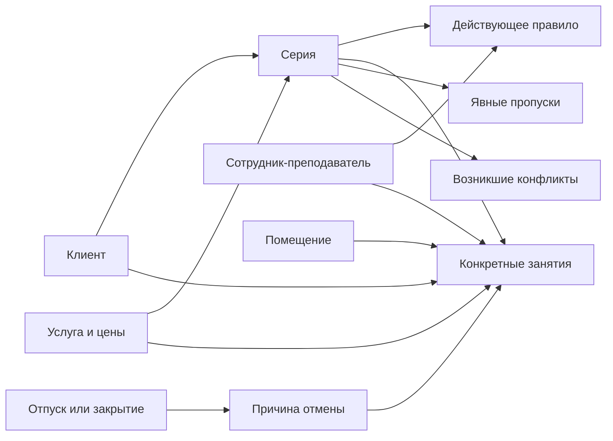

# Предметная модель

**Граница D-446:** вся механика курсов и домашних заданий отложена, включая персональное ДЗ без курса, материалы/учебные редакторы, прогресс, учебные уведомления и напоминания. Учебные описания ниже сохранены для возвращения к направлению; история переносится без потери. Свободная практика и обычные операции школы не откладываются.

## Основные правила

D-420: индивидуально настраиваемые политики с базовыми правами ролей и сохраняемыми личными исключениями D-447. D-422/D-445: занятие — одна встреча на одного или двух клиентов; статусы, результаты и списания участников индивидуальны. Общие время, преподаватель и помещение относятся к встрече; каждый участник платит обычную стоимость D-448, ДЗ отложено D-446. D-428: отдельная сущность абонемента исключена; денежная оплата отдельных занятий выбрана D-450; представление истории прежних покупок проектируется отдельно. D-436: вся механика курсов отложена. Перечисленные ниже старые сущности отражают историю проектирования и не утверждают наличие двух постоянных моделей.

Статус: подтверждённые бизнес-правила, словарь и предложения предметной модели. Каркас бэкенда согласован D-382, минимальная граница модели расписания — D-395. Это не окончательная SQL-схема и не готовность всей реализации.

## Подтверждённая модель школы

- Одна школа, одна установка.
- Одиночное занятие — полноценный сценарий; [поддержка пары необязательна](appointments.md#обязательность-поддержки-парных-занятий--d-518) D-518. При её реализации одна встреча содержит до двух клиентов с индивидуальными результатами и списаниями D-445/D-448.
- В школе несколько преподавателей, на занятии одновременно один преподаватель; выбор обязателен при создании.
- Помещение назначается по желанию. Пересечения занятий клиента, преподавателя или назначенного помещения запрещены.
- При выборе преподавателя показываются последние преподаватели этого клиента; это не источник учебных прав.
- Серия повторяется каждую неделю по выбранным дням со своим временем для каждого дня. Окончание — дата, количество занятий или бессрочно. Конфликтующие даты при создании можно явно пропустить после просмотра списка.
- При ограничении числом занятий пропуски конфликтующих дат при создании не входят в лимит: серия продлевается до полного количества назначенных встреч (D-025).
- До одобрения отпуска/графика конфликты разрешаются отменой, переносом или заменой преподавателя D-444.
- Любая отмена без списания; отмена и сгорание — разные состояния (D-035).
- Отмена участия перед отпуском не продлевает серию; сгорание входит в заданное число D-444/D-038.
- Сокращение/завершение/удаление отпуска не восстанавливает встречи и не меняет хвост D-444.
- Перенос времени и замена преподавателя в серии затрагивают одну встречу либо выбранную и последующие (D-028).
- Суперпользователь может выступать преподавателем занятия.
- Длительность услуги выбирается из 30/45/60/90/120 минут, по умолчанию 60. При записи не переопределяется, существующие занятия/серии сохраняют прежнее значение при изменении настройки услуги D-017, D-306–D-307. Услуга созданной записи/серии неизменна D-308; специализаций преподавателей по услугам нет D-309.
- Начало занятий — только целый час; окончания определяются длительностью (D-051).
- Цена учитывает личный резерв старой цены D-480 и оплату конкретной услуги D-481. Результат отмечается вручную; начисление относится к дате занятия.
- Оплаченные остатки и долг учитываются независимо по услугам; общий баланс отображается суммой с детализацией D-481/D-485. Свободного пополнения для всех услуг нет; отдельная сущность абонемента исключена D-428, исторические факты сохраняются.
- Прежние продления исключённой сущности сохраняются в исторических данных D-428; новой покупки нет D-450.
- На курс конкретного клиента назначаются один или несколько преподавателей; назначение определяет учебный доступ.
- Этап отношений вычисляется отдельно от состояния работы «В работе/Архив»; одна карточка и единые завершение/возобновление работы определены [D-537](clients.md#этап-отношений-и-состояние-работы--d-537). Карточки не удаляют насовсем D-100.
- Услуги архивируются; полное удаление только никогда не использованной услуги. Перед архивированием клиента/услуги явно отменяются будущие занятия и завершаются действующие серии (D-101, D-103–D-104).
- Архив клиента отзывает доступ на всех устройствах; разархивирование клиентов/услуг не восстанавливает расписание, клиенту выдаётся новая ссылка вместо активации старого доступа (D-105–D-106, D-108). Заметки и история текста читаются всеми сотрудниками, редактирование текущего поля — администратор/супер, клиенту закрыто D-432.
- Сохраняются ФИО, дата рождения, источник и заметки. Обязательны фамилия/имя и источник; контакты необязательны, допустим пустой список (D-418). Виды контактов — справочник суперпользователя на базе телефона/почты/ссылки; несколько одного вида и комментарии разрешены, телефоны международные (D-109–D-115).

## Словарь для согласования

| Термин | Рабочее определение | Что требуется решить |
| --- | --- | --- |
| Человек | Физический участник работы школы | Совмещение сотрудника и клиента, дубли и объединение |
| Аккаунт | Личность для входа: клиент по персональной ссылке, каждый сотрудник по личному аккаунту с паролем или passkey; общее переключение вкладок; второй фактор обязателен суперпользователю и администратору; смена прав/блокировка действуют сразу | Подключение и подробная процедура восстановления через суперпользователя/сервер |
| Сохранённый доступ | Запись отдельно от токенов; access token пять минут, refresh token сотрудника две недели с продлением при каждом успешном обновлении; истечение не удаляет запись; клиентское разрешение без срока до отзыва; замена/отзыв ссылки прекращает доступ на всех устройствах | Форматы/хранение токенов, клиентское обновление, выход, отдельное управление устройствами |
| Клиент | Одна карточка обращения/получателя занятий; вычисляемый этап отношений и единое состояние работы D-537; насовсем не удаляется; архив отзывает доступ; после разархивирования новая ссылка; обязательны фамилия/имя и источник; контакты необязательны D-418 | Точные формулы, форматы полей, интерфейс архива и история заметок |
| Контакт клиента | Запись выбранного вида со значением/комментарием; несколько одного вида разрешены, основной один; совпадение телефона/email между клиентами допустимо с предупреждением | Видимость, порядок, нормализация и выбор вида для сообщения |
| Вид контакта | Справочник суперпользователя на базе телефона/почты/ссылки; базовый формат фиксируется после использования, название меняется; архив сохраняет контакты, удаляется только неиспользованный | Дополнительные настройки, разархивирование и идентификация использования |
| Преподаватель | Читает своё расписание и меняет прогресс назначенных ему курсов клиентов; не меняет статусы занятий. Блокировка сохраняет назначения; до архива нужны замены в будущем расписании и незавершённых курсах, где он единственный, история сохраняется D-284–D-285. Как сотрудник может получить подписку любого клиента D-287 | Совмещение ролей и остальные видимые данные клиента |
| Услуга | Предложение школы с длительностью 30/45/60/90/120 (по умолчанию 60), денежной ценой и флагом консультации; архив/разархивирование, полное удаление только никогда не использованной | Исторические связи сохраняются, новые абонементы исключены |
| Занятие | Одна общая встреча на одного или двух клиентов: время, услуга, длительность, преподаватель, помещение | Индивидуальные результаты относятся к участию клиента D-445 |
| Участие клиента | Связь клиента с общей встречей, личный статус, результат, скидка и списание | Не создаёт второго интервала преподавателя/помещения D-445/D-448 |
| Сгоревшее участие | Ручная отметка неявки клиента со списанием его денежной стоимости | Не меняет результат второго участника |
| Отменённое занятие | Встреча не проводится, стоимость не списывается; компенсационные встречи не добавляются D-473 | Переходы, исправления, восстановление и история |
| Серия | Еженедельный план по дням/часам Europe/Moscow; до даты включительно, по числу назначенных встреч или бессрочно. Правка будущего сохраняет исключения других встреч; завершение с даты отменяет запланированное без задачи уведомления, не возобновляется D-310–D-313 | Сложный подсчёт при сочетании причин отмен, горизонт проверки, конфликты исключений и модель хранения |
| Вхождение | Устойчивая позиция занятия в серии | Идентичность, перенос, пропуск и восстановление |
| Рабочий график | Доступность преподавателя с регулярными и разовыми перерывами; подтверждается супером и действует сразу | Конфликты заранее разрешены отменой, переносом или заменой D-435/D-444 |
| Закрытие школы | До согласования конфликты разрешаются переносом, подходящей заменой преподавателя или отменой; компенсационных встреч нет D-473 | Судьба предложения восстановления D-271 — BIZ-46 |
| Отпуск | Точный интервал отсутствия клиента/сотрудника. До одобрения конфликты разрешены обычными действиями; изменения отпуска не восстанавливают занятия | Одобрение D-421, упрощение D-444 |
| Помещение | Необязательное место занятия: название, комментарий, архив; при архиве автоматически снимается с будущих занятий/серий с предупреждением, история сохраняется; удаление только никогда не использованного; пересечения запрещены, связей совместимости нет D-264, D-275–D-276 | Количество и конкретные записи справочника |
| Начисление клиенту | Стоимость участия при ручном результате с учётом личного резерва D-480; месяц по началу встречи | Оплата, исправления и возвраты — finances.md |
| Платёж | Зарегистрированное поступление денег | Авансы, распределение, возвраты, исправления и офлайн |
| Фактический возврат денег | Отдельный исходный факт выдачи денег обратно клиенту; уменьшает вычисляемый денежный баланс D-378 | Права, ограничения суммы/даты и исправления; не отмена ошибочного платежа/покупки |
| Маркетинговая кампания | Скидка с уникальным кодом, процентом/суммой; применяется при платеже, без личного срока и проверки сегмента клиента D-481 | Права и история сохраняются; остаток льготных занятий учитывается отдельно |
| Оплаченный остаток | Количество оплаченных занятий и сумма по каждой услуге; общий баланс — сумма с доступной детализацией. Долг по услугам независим, расход — от старых платежей D-485 | Резерв старой цены — D-480, цена на начало — D-484 |
| Прогноз | Месячная стоимость проведённых, сгоревших и запланированных участий D-184; прошедшее без результата исключается D-461, новые консультации бесплатны D-482 | Оценка с учётом личного резерва — finances.md |
| Курс | Долгосрочная программа обучения; изменения автоматически применяются к уже назначенным курсам клиентов D-123 | Структура Q-124 отложена до ответа заказчика; зависимости, исторический прогресс и последствия правок ещё описываются |
| Назначение курса | Участие клиента в программе с назначенными преподавателями; повторное прохождение с новым прогрессом и сохранением истории D-145; разные курсы можно проходить параллельно, у одного курса только одно активное прохождение клиента D-244. Назначают все сотрудники D-422 | Подробности исправления истории; учебная механика отложена D-446 |
| Преподаватели курса клиента | Один или несколько сотрудников, которым доступно изменение прогресса этого назначения | Изменение состава, замены и момент прекращения доступа |
| Освоение темы | Прогресс клиента: не начата, осваивается, ждёт проверки ДЗ, освоена; назначенный преподаватель может вернуть освоенную тему в работу | Остальные переходы, история и влияние отката на зависимые темы; [курсы](courses.md) |
| Доступность темы | Открытие по освоению всех зависимостей, включая темы параллельных веток; туман войны для закрытой части; при откате зависимости закрываются только не начатые темы без сброса прогресса D-143 | Видимость структуры Q-144; самозависимости и циклы запрещены D-411 |
| Домашнее задание темы | Общий фрагмент темы, открывается вместе с учебным материалом; загрузки работы клиентом на платформу на текущем этапе нет | Срок и будущая сдача/проверка; ручной статус ожидания проверки разрешён D-142 |
| Персональное задание | Необязательное ДЗ к занятию, видно клиенту сразу после сохранения, тема курса не требуется; содержание и отметка «выполнено» доступны для изменения преподавателю/суперпользователю, не администратору и не клиенту D-164–D-170 | Точная область учебных прав |
| Практика | Фиксированное упражнение ДЗ либо свободный тренажёр всем ролям. Свободная история у всех ролей, только самому запускающему D-364. Учебная история: клиент, назначенный преподаватель курса; персональное ДЗ — преподаватель занятия и супер D-365. Все попытки сохраняются с измерениями и историческими параметрами, включая прерванные D-360–D-363. Конфигурация свободной попытки применяется с перезаписью только при остановленном тренажёре D-366/D-371. Сотрудникам видео по сохранённой конфигурации, без исполнения пользователя; включённый метроном звучит, базовая длительность по зацикливанию/исторической продолжительности D-367–D-370. Цель не меняет учебный статус, баллов пока нет D-182 | Техническая модель фиксации/экспорта, кодек; анализ точности отложен |
| Игровые баллы | Результат правил геймификации | Начисление, отмена, периоды и рейтинги |
| Опыт темы и прохождения | У темы индивидуальный XP D-152; текущий опыт прохождения вычисляется по освоенным актуальным темам, отдельная сумма не хранится D-153–D-154 | Изменение награды и связь с другими игровыми баллами ещё не определены |
| Уровень курса | Порог XP в программе курса; текущий уровень клиента вычисляется по опыту конкретного прохождения D-155 | Оформление уровней и изменение порогов |
| Задача | Действие сотрудника в общей очереди без персонального назначения; выполненную/отменённую можно вернуть в работу, включая повторяющиеся и системные D-379. Возврат с конфликтующим/исчезнувшим основанием помечается проблемным D-437 | Детализация описания конфликта и системных оснований |
| Шаблон задачи | Общее описание содержания задачи; требуется удобный редактор | Поля, подстановки и влияние изменения на существующие задачи |
| Правило задачи | Условия появления задач; общими правилами управляет суперпользователь | Системные события, календарные параметры и выключение |
| Календарная задача | Разовая или повторяющаяся задача по Europe/Moscow без накопления копий при открытой/отложенной; после выполнения/отмены следующая будущая дата; отсутствующее число — последний день месяца. Опорная дата — D-327, повторное включение — D-329 | Точные поля времени и оставшиеся параметры правила |
| Уведомление | Сообщение о событии для пользователя | Получатель, прочтение, каналы и шум |
| Аудит | История значимых действий | Состав, доступ, хранение и связь с версией записи |

## Предлагаемые границы ответственности

Это способ обсуждать владельцев правил, а не требование создать отдельные сервисы или проекты.

- **Доступ:** аккаунты, сессии, обязанности и права.
- **Клиенты:** профиль, контакты, заметки, история отношений со школой.
- **Расписание:** занятия, серии, доступность, отпуска, помещения и согласование.
- **Обучение:** курсы, назначения, освоение и ДЗ.
- **Деньги:** начисления, поступления, расходы, баланс, прогноз и вознаграждение.
- **Практика:** упражнения, временная модель, запись и анализ.
- **Геймификация:** баллы, правила начисления и рейтинги.
- **Коммуникации:** задачи, уведомления, объявления и календарные подписки.

## Сквозные решения, которые нужно согласовать

### История и изменения

Какие факты остаются неизменными после завершения занятия, подтверждения прогресса или утверждения финансового периода? Что архивируется, что исправляется, что можно физически удалить? Кто и как возвращает действие в предыдущее состояние?

### Единые расчёты

Для всей системы выбран единый фиксированный Europe/Moscow D-141. Он используется в календарных правилах, повторениях, сроках и отображении. Зона устройства не меняет время интерфейса.

Все абсолютные отметки времени хранятся и передаются в UTC; преобразование в Europe/Moscow для отображения выполняется на клиенте D-133, D-141. Даты без времени, например дата рождения, остаются календарными датами. Недельные повторения и календарные месяцы рассчитываются по Europe/Moscow; результирующие моменты встреч и истечения срока остаются UTC. Детали — [архитектура](architecture.md#подтверждённые-решения).

Подтверждено: у каждого участника ручной результат, оплата по услуге и личный резерв старой цены D-480/D-481; отчётный месяц по началу встречи D-430/D-445. Отмена без списания; снятие результата освобождает использование скидки D-451. Правила финансовых исправлений, отчётов и возврата — в finances.md.

Какие статусы создают посещение, занятость и прогноз? Как учитываются консультации, переносы и цены? Одинаковые понятия должны иметь одну формулу независимо от экрана.

### Длительность

Подтверждено: услуга задаёт исходную длительность. Изменение услуги влияет на новые занятия и новые серии, а существующая серия сохраняет длительность для своих будущих вхождений.

Предложение: обычный перенос времени сохраняет прежнюю длительность и не трактуется как создание новой серии только из-за технического устройства операции. Правила изменения будущей части ещё обсуждаются.

Подтверждены список длительностей D-306, отсутствие ручного переопределения D-307 и неизменность услуги созданной записи/серии D-308. Изменение будущего плана сохраняет прежнюю длительность, явно новая серия получает текущую настройку услуги. Подробности — [занятия и услуги](appointments.md).

### Идентичность и повторения

Сохраняется ли ID после заметки, смены темы и переноса? Чем временная недоступность отличается от подтверждённой отмены? Может ли открытие экрана менять состав расписания? Как изменяется будущая часть серии?

### Время

Единый Europe/Moscow для календарных расчётов и отображения D-141, UTC для абсолютных моментов D-133; начало недели; реальные интервалы отпусков; длительность; срок напоминания; принадлежность операции отчётному периоду.

### Версии и офлайн

По D-234, D-239 разные пользователи работают параллельно; совместный онлайн-редактор не требуется. Полная офлайн-работа с редактором конфликтов принята D-449, доступ до синхронизации и проверка по текущим правам — D-497/D-499. Глобального ограничения одним пользователем нет. Собственная версия каждой записи не выбрана как обязательная модель. Остаются детали протокола, целостность команд, влияние новых отпусков и изменённых цен. Простые локальные черновики D-233 сохраняются в этом объёме.

### События и последствия

Каждая согласованная операция должна описывать влияние на связанные данные и экраны. Задача на действие, уведомление о событии и запись аудита рассматриваются отдельно; выполнение одного не подменяет другое.

## Примеры, на которых будет проверяться модель

1. Отпуск клиента пересекает одиночное занятие и нематериализованное вхождение серии.
2. Конфликтующее занятие удалено после появления временной недоступности повторения.
3. Сотрудник меняет график после подачи заявки, но до её одобрения.
4. Администратор добавляет заметку в занятие серии и переносит другое вхождение.
5. Клиент оплатил аванс; цена услуги изменилась до будущего урока.
6. Новая бесплатная консультация попадает в карточку клиента и дашборд без платной стоимости в прогнозе D-482; исторические платные факты сохраняются.
7. В курсе меняются порядок, зависимости и награда ранее пройденной темы.
8. Один клиент имеет два близких урока и задачу о ДЗ.
9. Два преподавателя пытаются назначить одно помещение в пересекающееся время.
10. Офлайн-команда возвращается после изменения прав или серверной версии записи.
11. Услуга меняется с 60 на 45 минут: прежние занятия и вхождения существующей серии сохраняют 60 минут, новые занятия и серии получают 45 минут.
12. На курс клиента назначены два преподавателя; оба работают с прогрессом этого курса, при этом каждое занятие имеет одного преподавателя.
13. Неявка без предупреждения списывает стоимость; повторная отметка того же сгорания не должна списывать её повторно (предлагаемый критерий приёмки).

Для подтверждённых примеров применяются указанные D-ID. Оставшиеся неоднозначности согласуются отдельно; учебные сценарии отложены D-446.

## Публичные данные школы — D-349–D-359

Публичный сайт — лендинг школы и страницы преподавателей. Публичная видимость услуги независима от её доступности внутри школы, расписания, расчётов и календарных подписок D-357. Состав лендинга и ручные публичные цены — D-479; автоматическое получение тарифов пока является возможным направлением. Расчёт занятий учитывает личный резерв D-480.

Флаг участия преподавателя влияет на выбор для новых записей и показ на лендинге. По D-354 для него не вводится отдельный процесс переназначения будущих встреч: основной случай — разработчик-супер, никогда не участвовавший в расписании. Флаг не тождественен роли, блокировке или архиву; сам по себе не отменяет записи и не меняет учебные назначения/историю.

Публичные сведения преподавателя: имя, фото, описание, опыт, направления. Они не публикуются автоматически из закрытого аккаунта. Преподаватель редактирует свою страницу; супер управляет общими данными и флагом участия. Направления не ограничивают назначение услуг. Мессенджер и звонок настраиваются в данных сайта. Редактор не меняет дизайн; предпросмотр и сохранение с немедленным применением без отдельной публикации D-359. Конкретная схема хранения и API ещё не выбираются.

## Минимальная модель расписания — D-395

Статус: граница первой реализации подтверждена D-395; это ещё не окончательная SQL-схема. Текущие модели и правила написаны на C# D-455. Модель опирается на правила scheduling.md/appointments.md и каркас D-382. Названия ниже — предметные понятия; количество понятий не означает такое же количество таблиц, агрегатов или сервисов.

| ID | Понятие | Минимальные данные и назначение |
| --- | --- | --- |
| SCHED-M-001 | Клиент | Существующая клиентская идентичность; ссылка из занятия/серии, архив и контакты по clients.md. Баланс и стадия клиента вычисляются отдельно |
| SCHED-M-002 | Сотрудник, участвующий как преподаватель | Одна идентичность сотрудника с ролью и флагом участия; у супера нет второй независимой карточки преподавателя. Архив/блокировка/флаг участия имеют разные последствия |
| SCHED-M-003 | Услуга и периоды цен | Ссылка на услугу, признак консультации, длительность для новых записей, история начала действия цен. Публичная видимость не определяет внутреннюю доступность услуги |
| SCHED-M-004 | Помещение | Необязательная ссылка на простой справочник; архив/удаление по согласованным правилам, без универсального каталога ресурсов |
| SCHED-M-005 | Конкретная встреча | UUIDv7, услуга, обязательный преподаватель, помещение, начало UTC и фиксированная длительность; серия и стабильный номер при повторении. Участников один/два, результат не дублируется единым полем встречи |
| SCHED-M-006 | Серия | Стабильная идентичность, участники/услуга, зафиксированная длительность, дата начала, тип окончания: дата включительно/число/бессрочно, действующее правило повторения и следующий порядковый номер. Завершение серии и причины отмен отдельных встреч — разные факты |
| SCHED-M-007 | Действующее правило серии | Выбранные московские дни недели и время каждого дня, преподаватель и помещение. Правка «это и следующие» обновляет правило и уже созданную будущую часть; отдельная история версий правила на первом этапе не вводится |
| SCHED-M-008 | Явный пропуск | Подтверждённый сотрудником пропуск рассчитанной даты со стабильным порядковым номером и причиной. Создаётся только при фактическом пропуске и не требует общей записи для всех остальных дат |
| SCHED-M-009 | Причина отмены | Связь участия/встречи с основанием, автором и действием для истории. При отпусках и закрытиях конфликты разрешаются до согласования, автоматической отмены при согласовании нет D-473. Детализация предложения восстановления при изменении закрытия отложена D-491 |
| SCHED-M-010 | Отпуск | Точные UTC-интервалы и субъект — клиент либо преподаватель, связь с сотруднической заявкой при её наличии. Клиентский отпуск создаёт сотрудник D-476; сотруднический одобряет супер D-421. Заявка и уже действующий отпуск не подменяют друг друга |
| SCHED-M-011 | Рабочий график и перерывы | Согласованная версия графика преподавателя с датой действия, недельными рабочими интервалами и перерывами; разовые интервалы отдельно от недельного правила |
| SCHED-M-012 | Закрытие школы | Точный интервал недоступности школы и причина, управление супером. Общая проверка доступности использует его наряду с отпусками и графиком |
| SCHED-M-013 | Неразрешённый конфликт | Отдельный факт реально возникшей проблемы: серия, стабильный порядковый номер, желаемое время/участники и принятое решение сотрудника. Конфликтующая встреча при этом отсутствует; актуальная причина получается повторной проверкой. Связь с задачей ведёт в интерфейс разбора |

По D-395 не создаётся универсальная сущность для каждой рассчитанной даты серии. Занятие, конфликт и явный пропуск хранятся как отдельные факты только при их возникновении и связываются парой «серия + порядковый номер». Полная история версий правила и универсальная сущность исключения также не вводятся без конкретной необходимости; историю операций сохраняет аудит.

Правила хранения и расчёта:

1. Кандидаты серии получают возрастающие порядковые номера в исходном порядке, включая даты, ставшие явными пропусками или конфликтами. Занятие сохраняет свой номер при переносе, замене преподавателя и изменении темы/ДЗ; фактическое время не определяет принадлежность к части серии.
2. Время окончания получается из начала и зафиксированной длительности; отдельная независимо редактируемая копия окончания не нужна. Цена и оплата каждого участника учитывают услугу и личный резерв D-480/D-481. Само наличие занятия не означает списания денег.
3. Каждый участник имеет статус: запланировано, проведено, сгорело или отменено. Результат одного не меняет другого; удаление ошибочной встречи требует отсутствия действующих списаний обоих. Общая занятость есть, если хотя бы один участник запланирован/проведён D-433/D-445.
4. У индивидуально изменённой встречи сохраняется, какие поля переопределены сотрудником. Правка «это и последующие» одной прикладной операцией обновляет действующее правило и уже созданные будущие занятия, но не затирает индивидуальные изменения остальных встреч. Единственный действующий результат/статус относится к участию клиента D-445 и не дублируется независимо в «исключении» и календаре.
5. Действующее правило определяет обычное повторение, конкретное занятие — фактическую запись. Отмена не прячется в фильтре видимости: у встречи есть отмена и основание; все представления календаря/портала/ICS используют общее правило состояния. Явный пропуск и конфликт не материализуются как занятия.
6. Проверка доступности объединяет рабочие часы, перерывы, отпуска, закрытия и пересечения клиента/преподавателя/помещения. Одного проверочного чтения перед записью недостаточно: конкретные SQL-ограничения/блокировки будут выбраны вместе со схемой. Отдельный движок универсальных ресурсов не требуется.
7. По D-444 перед одобрением отпуска/графика конфликты разрешаются обычной отменой, переносом или заменой преподавателя. Сокращение/удаление отпуска не меняет занятия автоматически.
8. Для уже созданной серии отмена перед отпуском не добавляет компенсационных встреч D-444. Перенос/замена преподавателя сохраняют встречу. Специального восстановления хвоста при изменении отпуска нет. Первоначальный набор числа встреч D-025 сохраняется.
9. Исполнение команды сохраняет связанные факты и аудит согласованно. Чтение календаря/ICS/отчёта не решает постоянную судьбу рассчитанной даты, не создаёт отмен и не списывает баланс. Фоновый обработчик использует те же прикладные правила.

Пример: серия по понедельникам в 18:00 на восемь встреч. Индивидуально третья перенесена на среду; перенос сохраняет её ID и исходный порядковый номер. Правка действующего правила с пятой встречи на 19:00 меняет обычные последующие встречи, сохраняя индивидуальные изменения D-311. Если пятая и шестая встречи конфликтуют с новым отпуском, до одобрения их отменяют, переносят или меняют преподавателя. При отмене хвост не добавляется; после сокращения отпуска встречи сами не восстанавливаются D-444.

По D-383 для бессрочной серии создаются конкретные встречи на 12 месяцев вперёд, окно регулярно продлевается, проверенный период виден в предпросмотре. Конечную серию по-прежнему предлагается разбирать до её даты/числа. По D-384 при позднем конфликте встреча не создаётся: сохраняется проблема для явного разбора и появляется задача ресепшену. Это не явный пропуск сотрудником и не скрытая встреча. Частота продления и поведение дальнего просмотра ещё проектируются; проверка бесконечного числа дат не утверждается.

D-383–D-386 определяют горизонт серии, порядок вхождений и область изменения помещения. Принадлежность к будущей части определяется порядковым номером, независимо от переноса. Помещение меняется/снимается для одной встречи или выбранной и следующих с сохранением индивидуальных изменений. D-387–D-389: одна открытая задача на серию, ручное подтверждение ранее конфликтной даты и клиентское предупреждение. D-395 фиксирует минимальную границу хранения без универсального реестра вхождений и версий правила; конкретные SQL-ограничения ещё проектируются.

### Разбор конфликта: границы данных и команд

Подтверждено D-384/D-395: конфликт нужно явно разобрать и сохранить по паре «серия + порядковый номер», чтобы повторный фоновый проход не создавал копии задачи/проблемы и не превращал неразрешённую дату в согласованный пропуск. Задача ведёт к проблеме; простая отметка задачи выполненной не считается созданием занятия или явным пропуском.

Предлагаемые команды: получить актуальные причины; проверить выбранное исправление; применить исправление одной даты или действующего правила серии; явно пропустить дату. Успешное применение сохраняет занятие, конфликт/пропуск и аудит согласованно. Перед записью проверяются актуальные ограничения, даже если предпросмотр был успешным. Технический API ещё не выбран.

При исчезновении причины, завершении/изменении серии и прошедшей проблемной дате сохраняется история и актуальность проблемы. По D-388 ранее конфликтная дата остаётся ожидающей ручного подтверждения даже после исчезновения препятствия. Фоновое продление учитывает существующую проблему до создания встречи. По D-387 серия имеет один открытый разбор/задачу со всеми проблемными датами; по D-389 клиент читает собственное предупреждение без чужих подробностей. Текущая готовность вычисляется проверкой доступности; историческая проблема/решение — отдельные факты.
