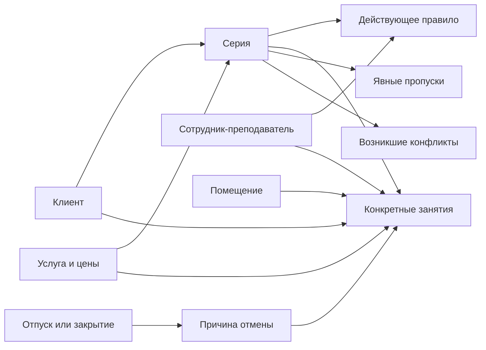

# Предметная модель

Статус: подтверждённые бизнес-правила, словарь и предложения предметной модели. Каркас бэкенда согласован D-382; новая модель расписания ниже остаётся предложением. Это не окончательная SQL-схема и не реализация.

## Подтверждённая модель школы

- Одна школа, одна установка.
- Занятия индивидуальные.
- В школе несколько преподавателей, на занятии одновременно один преподаватель; выбор обязателен при создании.
- Помещение назначается по желанию. Пересечения занятий клиента, преподавателя или назначенного помещения запрещены.
- При выборе преподавателя показываются последние преподаватели этого клиента; это не источник учебных прав.
- Серия повторяется каждую неделю по выбранным дням со своим временем для каждого дня. Окончание — дата, количество занятий или бессрочно. Конфликтующие даты при создании можно явно пропустить после просмотра списка.
- При ограничении числом занятий пропуски конфликтующих дат при создании не входят в лимит: серия продлевается до полного количества назначенных встреч (D-025).
- Новый отпуск клиента или преподавателя автоматически отменяет пересекающиеся запланированные занятия и создаёт задачи на уведомление клиентов (D-026–D-027).
- Любая отмена без списания; отмена и сгорание — разные состояния (D-035).
- Отмены из-за отпуска продлевают серию по количеству; ручная отмена не продлевает, сгорание входит в заданное число (D-033, D-037–D-038).
- После сокращения/раннего завершения/удаления отпуска восстановление отменённых из-за него встреч предлагается с проверкой занятости. Сотрудник подтверждает восстановление и замену лишних добавленных встреч в конце (D-034, D-036).
- Перенос времени и замена преподавателя в серии затрагивают одну встречу либо выбранную и последующие (D-028).
- Суперпользователь может выступать преподавателем занятия.
- Длительность услуги выбирается из 30/45/60/90/120 минут, по умолчанию 60. При записи не переопределяется, существующие занятия/серии сохраняют прежнее значение при изменении настройки услуги D-017, D-306–D-307. Услуга созданной записи/серии неизменна D-308; специализаций преподавателей по услугам нет D-309.
- Начало занятий — только целый час; окончания определяются длительностью (D-051).
- Цена по времени окончания занятия, независимо от даты планирования. Результат отмечается вручную; списание при отметке с начислением по дате занятия (D-046–D-050).
- Денежный баланс клиента единый. Абонементы на четыре/восемь имеют отдельный остаток и месячный срок с покупки; покрытая встреча расходует единицу, отпуск продлевает срок (D-052–D-057).
- Абонемент заканчивается в то же время следующего месяца, короткий месяц — последний день; покрытие по началу встречи. Отпуска задаются точным временем, связанные пересечения учитываются один раз (D-064–D-068).
- При покупке во время отпуска учитывается только время после покупки. Уже выданное продление не уменьшается при сокращении/раннем завершении/удалении отпуска (D-071–D-072).
- На курс конкретного клиента назначаются один или несколько преподавателей; назначение определяет учебный доступ.
- Состояния клиента вычисляются, отдельная ручная шкала стадий не хранится. Закрытие лида заменено архивированием; клиентов не удаляют насовсем (D-099–D-100, D-102).
- Услуги архивируются; полное удаление только никогда не использованной услуги. Перед архивированием клиента/услуги явно отменяются будущие занятия и завершаются действующие серии (D-101, D-103–D-104).
- Архив клиента отзывает доступ на всех устройствах; разархивирование клиентов/услуг не восстанавливает расписание, клиенту выдаётся новая ссылка вместо активации старого доступа (D-105–D-106, D-108). Произвольные заметки карточки только для администратора/суперпользователя (D-107).
- Сохраняются ФИО, дата рождения, источник и заметки. Обязательны фамилия/имя, источник и хотя бы один контакт. Виды контактов — справочник суперпользователя на базе телефона/почты/ссылки; несколько одного вида и комментарии разрешены, телефоны международные (D-109–D-115).

## Словарь для согласования

| Термин | Рабочее определение | Что требуется решить |
| --- | --- | --- |
| Человек | Физический участник работы школы | Совмещение сотрудника и клиента, дубли и объединение |
| Аккаунт | Личность для входа: клиент по персональной ссылке, каждый сотрудник по личному аккаунту с паролем или passkey; общее переключение вкладок; второй фактор обязателен суперпользователю и администратору; смена прав/блокировка действуют сразу | Подключение и подробная процедура восстановления через суперпользователя/сервер |
| Сохранённый доступ | Запись отдельно от токенов; access token пять минут, refresh token сотрудника две недели с продлением при каждом успешном обновлении; истечение не удаляет запись; клиентское разрешение без срока до отзыва; замена/отзыв ссылки прекращает доступ на всех устройствах | Форматы/хранение токенов, клиентское обновление, выход, отдельное управление устройствами |
| Клиент | Получатель индивидуальных занятий; состояние вычисляется, закрытие лида заменено архивом; насовсем не удаляется; архив отзывает доступ; после разархивирования новая ссылка; обязательны фамилия/имя, источник и контакт | Точные формулы, форматы полей, интерфейс архива и история заметок |
| Контакт клиента | Запись выбранного вида со значением/комментарием; несколько одного вида разрешены, основной один; совпадение телефона/email между клиентами допустимо с предупреждением | Видимость, порядок, нормализация и выбор вида для сообщения |
| Вид контакта | Справочник суперпользователя на базе телефона/почты/ссылки; базовый формат фиксируется после использования, название меняется; архив сохраняет контакты, удаляется только неиспользованный | Дополнительные настройки, разархивирование и идентификация использования |
| Преподаватель | Читает своё расписание и меняет прогресс назначенных ему курсов клиентов; не меняет статусы занятий. Блокировка сохраняет назначения; до архива нужны замены в будущем расписании и незавершённых курсах, где он единственный, история сохраняется D-284–D-285. Как сотрудник может получить подписку любого клиента D-287 | Совмещение ролей и остальные видимые данные клиента |
| Услуга | Предложение школы с длительностью по умолчанию 60 минут и правилами стоимости; явный флаг консультации D-212; архив с сохранением истории и возможностью разархивирования без восстановления расписания; полное удаление только неиспользованной | Цены, единицы, абонементы и изменение длительности отдельного занятия |
| Занятие | Конкретная индивидуальная встреча с временем, собственной длительностью, обязательным одним преподавателем и необязательным помещением | Переходы статусов и замены |
| Сгоревшее занятие | Неявка без предупреждения; расход денежной стоимости либо единицы покрывающего абонемента при ручной отметке | Выбор источника оплаты, исправления и консультации |
| Отменённое занятие | Встреча не проводится, стоимость не списывается; причина влияет на продление серии | Переходы, исправления, восстановление и история |
| Серия | Еженедельный план по дням/часам Europe/Moscow; до даты включительно, по числу назначенных встреч или бессрочно. Правка будущего сохраняет исключения других встреч; завершение с даты отменяет запланированное без задачи уведомления, не возобновляется D-310–D-313 | Сложный подсчёт при сочетании причин отмен, горизонт проверки, конфликты исключений и модель хранения |
| Вхождение | Устойчивая позиция занятия в серии | Идентичность, перенос, пропуск и восстановление |
| Рабочий график | Доступность преподавателя с регулярными и разовыми перерывами; преподаватель готовит изменения, суперпользователь согласует; возможна будущая дата начала; конфликтующие встречи переносятся, а не отменяются, без продления абонемента D-259–D-268, D-277–D-278 | Точная временная граница начала и согласование переносов, если время ещё не выбрано |
| Закрытие школы | Общий интервал недоступности школы под управлением суперпользователя; запрещает запись, отменяет встречи без списания с задачами уведомления; продлевает серии и абонементы по принципам отпусков, при сокращении/удалении предлагает восстановление D-263, D-269–D-273 | Детализация расчёта и восстановления по общим правилам |
| Отпуск | Точный интервал отсутствия клиента/сотрудника; новый отпуск отменяет занятия с задачами уведомления, после сокращения/удаления предлагается восстановление | Согласование, история, сложное восстановление, расширение и календарь |
| Помещение | Необязательное место занятия: название, комментарий, архив; при архиве автоматически снимается с будущих занятий/серий с предупреждением, история сохраняется; удаление только никогда не использованного; пересечения запрещены, связей совместимости нет D-264, D-275–D-276 | Количество и конкретные записи справочника |
| Начисление клиенту | Денежная стоимость занятия, учитываемая при ручной отметке по дате занятия; покрытие абонементом расходует единицу без повторного денежного списания | Исправления, покупка/выбор источника оплаты и дата при пересечении полуночи |
| Платёж | Зарегистрированное поступление денег | Авансы, распределение, возвраты, исправления и офлайн |
| Фактический возврат денег | Отдельный исходный факт выдачи денег обратно клиенту; уменьшает вычисляемый денежный баланс D-378 | Права, ограничения суммы/даты и исправления; не отмена ошибочного платежа/покупки |
| Маркетинговая кампания | Неизменяемая скидка с уникальным кодом, процентом/суммой и сроком; ручной код или генерация пяти букв/цифр. Супер создаёт, останавливает новые активации с сохранением выданных прав, удаляет только без любых активаций. Супер/администратор активирует для клиента/услуги один раз, отмены активации нет. Применение по количеству, сроку или одной покупке абонемента 4/8/оба; отмена допустимой покупки восстанавливает скидочное право. Возвращение по последнему проведённому/сгоревшему обычному занятию любой услуги D-198–D-215, D-314–D-321 | Форматы ручного кода/алфавит, границы временных условий, техническая модель |
| Баланс | Единый вычисляемый денежный остаток клиента для всех услуг; может быть отрицательным, не блокируя запись; отдельное независимо обновляемое значение не хранится D-190 | Первичные данные входящих платежей/фактических возвратов/покупок/стоимости занятий, история цен, дата расчёта и единое правило всех экранов |
| Абонемент | Покрытие 4/8 занятий с месячным сроком с покупки по Europe/Moscow, с согласованными продлениями; остаток вычисляется по выданному количеству и действующим покрытиям, срок и количество ограничивают использование; источники покрытия сохраняются; покупка в долг разрешена, после любого прошлого использования её отмена запрещена D-187, D-301, D-305 | Цена Q-064, область услуг Q-061, применимость отпусков и равные сроки выбора |
| Остаток абонемента | Доступные единицы занятий, отдельные от денежного баланса и числа встреч серии | Истечение, исправления, несколько абонементов и поздние отметки |
| Прогноз | Месячная стоимость проведённых, сгоревших и запланированных занятий, включая оплаченные и не оплаченные D-184 и платные консультации D-186 | Оценка абонементных занятий, прошедшие записи без результата и представление |
| Курс | Долгосрочная программа обучения; изменения автоматически применяются к уже назначенным курсам клиентов D-123 | Структура Q-124 отложена до ответа заказчика; зависимости, исторический прогресс и последствия правок ещё описываются |
| Назначение курса | Участие клиента в программе с назначенными преподавателями; повторное прохождение с новым прогрессом и сохранением истории D-145; разные курсы можно проходить параллельно, у одного курса только одно активное прохождение клиента D-244 | Кто назначает преподавателей и подробности исправления истории |
| Преподаватели курса клиента | Один или несколько сотрудников, которым доступно изменение прогресса этого назначения | Изменение состава, замены и момент прекращения доступа |
| Освоение темы | Прогресс клиента: не начата, осваивается, ждёт проверки ДЗ, освоена; назначенный преподаватель может вернуть освоенную тему в работу | Остальные переходы, история и влияние отката на зависимые темы; [курсы](courses.md) |
| Доступность темы | Открытие по освоению всех зависимостей, включая темы параллельных веток; туман войны для закрытой части; при откате зависимости закрываются только не начатые темы без сброса прогресса D-143 | Видимость структуры Q-144; самозависимости и циклы запрещены D-411 |
| Домашнее задание темы | Общий фрагмент темы, открывается вместе с учебным материалом; загрузки работы клиентом на платформу на текущем этапе нет | Срок и будущая сдача/проверка; ручной статус ожидания проверки разрешён D-142 |
| Персональное задание | Необязательное ДЗ к занятию, видно клиенту сразу после сохранения, тема курса не требуется; содержание и отметка «выполнено» доступны для изменения преподавателю/суперпользователю, не администратору и не клиенту D-164–D-170 | Точная область учебных прав |
| Практика | Фиксированное упражнение ДЗ либо свободный тренажёр всем ролям. Свободная история у всех ролей, только самому запускающему D-364. Учебная история: клиент, назначенный преподаватель курса; персональное ДЗ — преподаватель занятия и супер D-365. Все попытки сохраняются с измерениями и историческими параметрами, включая прерванные D-360–D-363. Конфигурация свободной попытки применяется с перезаписью только при остановленном тренажёре D-366/D-371. Сотрудникам видео по сохранённой конфигурации, без исполнения пользователя; включённый метроном звучит, базовая длительность по зацикливанию/исторической продолжительности D-367–D-370. Цель не меняет учебный статус, баллов пока нет D-182 | Техническая модель фиксации/экспорта, кодек; анализ точности отложен |
| Игровые баллы | Результат правил геймификации | Начисление, отмена, периоды и рейтинги |
| Опыт темы и прохождения | У темы индивидуальный XP D-152; текущий опыт прохождения вычисляется по освоенным актуальным темам, отдельная сумма не хранится D-153–D-154 | Изменение награды и связь с другими игровыми баллами ещё не определены |
| Уровень курса | Порог XP в программе курса; текущий уровень клиента вычисляется по опыту конкретного прохождения D-155 | Оформление уровней и изменение порогов |
| Задача | Действие сотрудника в общей очереди без персонального назначения; выполненную/отменённую можно вернуть в работу, включая повторяющиеся и системные D-379 | Срок/актуальность, конфликт возврата при уже открытой следующей задаче, состояние основания |
| Шаблон задачи | Общее описание содержания задачи; требуется удобный редактор | Поля, подстановки и влияние изменения на существующие задачи |
| Правило задачи | Условия появления задач; общими правилами управляет суперпользователь | Системные события, календарные параметры и выключение |
| Календарная задача | Разовая или повторяющаяся задача по Europe/Moscow без накопления копий при открытой/отложенной; после выполнения/отмены следующая будущая дата; отсутствующее число — последний день месяца | Границы, опорная дата интервала, текущий просроченный срок и повторное включение |
| Уведомление | Сообщение о событии для пользователя | Получатель, прочтение, каналы и шум |
| Аудит | История значимых действий | Состав, доступ, хранение и связь с версией записи |

## Предлагаемые границы ответственности

Это способ обсуждать владельцев правил, а не требование создать отдельные сервисы или проекты.

- **Доступ:** аккаунты, сессии, обязанности и права.
- **Клиенты:** профиль, контакты, заметки, история отношений со школой.
- **Расписание:** занятия, серии, доступность, отпуска, помещения и согласование.
- **Обучение:** курсы, назначения, освоение и ДЗ.
- **Деньги:** начисления, поступления, расходы, баланс, прогноз и вознаграждение.
- **Практика:** упражнения, временная модель, запись и анализ.
- **Геймификация:** баллы, правила начисления и рейтинги.
- **Коммуникации:** задачи, уведомления, объявления и календарные подписки.

## Сквозные решения, которые нужно согласовать

### История и изменения

Какие факты остаются неизменными после завершения занятия, подтверждения прогресса или утверждения финансового периода? Что архивируется, что исправляется, что можно физически удалить? Кто и как возвращает действие в предыдущее состояние?

### Единые расчёты

Для всей системы выбран единый фиксированный Europe/Moscow D-141. Он используется в календарных правилах, повторениях, сроках и отображении. Отдельные зоны преподавателей D-130 отменены; зона устройства не меняет время интерфейса.

Все абсолютные отметки времени хранятся и передаются в UTC; преобразование в Europe/Moscow для отображения выполняется на клиенте D-133, D-141. Даты без времени, например дата рождения, остаются календарными датами. Недельные повторения и календарные месяцы рассчитываются по Europe/Moscow; результирующие моменты встреч и истечения срока остаются UTC. Детали — [архитектура](architecture.md#время).

Подтверждено: ручная отметка проведения/сгорания учитывается по дате занятия. При денежной оплате списывается цена на время окончания; при покрытии абонементом — единица без повторного денежного списания. Денежный баланс единый для всех услуг. Любая отмена без списания; при отпусках применяется отмена, а не сгорание. Пока результат не отмечен, автоматического проведения и списания по нему нет. Исправления и другие правила ещё обсуждаются. Подробности — [финансы](finances.md) и [абонементы](subscriptions.md).

Какие статусы создают посещение, занятость и прогноз? Как учитываются консультации, переносы и цены? Одинаковые понятия должны иметь одну формулу независимо от экрана.

### Длительность

Подтверждено: услуга задаёт исходную длительность. Изменение услуги влияет на новые занятия и новые серии, а существующая серия сохраняет длительность для своих будущих вхождений.

Предложение: обычный перенос времени сохраняет прежнюю длительность и не трактуется как создание новой серии только из-за технического устройства операции. Правила изменения будущей части ещё обсуждаются.

Подтверждены список длительностей D-306, отсутствие ручного переопределения D-307 и неизменность услуги созданной записи/серии D-308. Изменение будущего плана сохраняет прежнюю длительность, явно новая серия получает текущую настройку услуги. Подробности — [занятия и услуги](appointments.md).

### Идентичность и повторения

Сохраняется ли ID после заметки, смены темы и переноса? Чем временная недоступность отличается от подтверждённой отмены? Может ли открытие экрана менять состав расписания? Как изменяется будущая часть серии?

### Время

Единый Europe/Moscow для календарных расчётов и отображения D-141, UTC для абсолютных моментов D-133; начало недели; реальные интервалы отпусков; длительность; срок напоминания; принадлежность операции отчётному периоду.

### Версии и офлайн

По D-234, D-239 разные пользователи работают параллельно; специальный совместный редактор и интерфейс сверки правок не требуются. Глобального ограничения одним пользователем нет. Собственная версия каждой записи не выбрана как обязательная модель. Остаются целостность команд и повторных запросов, влияние новых отпусков и изменённых цен. По D-233 приняты простые локальные черновики; допустимые полноценные офлайн-операции остаются у заказчика.

### События и последствия

Каждая согласованная операция должна описывать влияние на связанные данные и экраны. Задача на действие, уведомление о событии и запись аудита рассматриваются отдельно; выполнение одного не подменяет другое.

## Примеры, на которых будет проверяться модель

1. Отпуск клиента пересекает одиночное занятие и нематериализованное вхождение серии.
2. Конфликтующее занятие удалено после появления временной недоступности повторения.
3. Сотрудник меняет график после подачи заявки, но до её одобрения.
4. Администратор добавляет заметку в занятие серии и переносит другое вхождение.
5. Клиент оплатил аванс; цена услуги изменилась до будущего урока.
6. Платная консультация попадает в карточку клиента, дашборд и отчёт.
7. В курсе меняются порядок, зависимости и награда ранее пройденной темы.
8. Один клиент имеет два близких урока и задачу о ДЗ.
9. Два преподавателя пытаются назначить одно помещение в пересекающееся время.
10. Офлайн-команда возвращается после изменения прав или серверной версии записи.
11. Услуга меняется с 60 на 45 минут: прежние занятия и вхождения существующей серии сохраняют 60 минут, новые занятия и серии получают 45 минут.
12. На курс клиента назначены два преподавателя; оба работают с прогрессом этого курса, при этом каждое занятие имеет одного преподавателя.
13. Неявка без предупреждения списывает стоимость; повторная отметка того же сгорания не должна списывать её повторно (предлагаемый критерий приёмки).

Ответы для этих примеров пока не назначены. Они будут следовать из решений пользователя.

## Публичные данные школы — D-349–D-359

Публичный сайт — лендинг школы и страницы преподавателей. Публичная видимость услуги независима от её доступности внутри школы, расписания, расчётов и календарных подписок D-357. Показывается действующая сейчас цена из существующей истории цен, автоматически с наступлением новой цены D-358, без второй независимо редактируемой цены. Расчёт конкретного занятия остаётся по времени окончания.

Флаг участия преподавателя влияет на выбор для новых записей и показ на лендинге. По D-354 для него не вводится отдельный процесс переназначения будущих встреч: основной случай — разработчик-супер, никогда не участвовавший в расписании. Флаг не тождественен роли, блокировке или архиву; сам по себе не отменяет записи и не меняет учебные назначения/историю.

Публичные сведения преподавателя: имя, фото, описание, опыт, направления. Они не публикуются автоматически из закрытого аккаунта. Преподаватель редактирует свою страницу; супер управляет общими данными и флагом участия. Направления не ограничивают назначение услуг. Мессенджер и звонок настраиваются в данных сайта. Редактор не меняет дизайн; предпросмотр и сохранение с немедленным применением без отдельной публикации D-359. Конкретная схема хранения и API ещё не выбираются.

## Минимальная модель расписания — D-395

Статус: граница первой реализации подтверждена D-395; это ещё не окончательная SQL-схема или набор F#-типов. Модель опирается на правила scheduling.md/appointments.md и каркас D-382. Названия ниже — предметные понятия; количество понятий не означает такое же количество таблиц, агрегатов или сервисов.

| ID | Понятие | Минимальные данные и назначение |
| --- | --- | --- |
| SCHED-M-001 | Клиент | Существующая клиентская идентичность; ссылка из занятия/серии, архив и контакты по clients.md. Баланс и стадия клиента вычисляются отдельно |
| SCHED-M-002 | Сотрудник, участвующий как преподаватель | Одна идентичность сотрудника с ролью и флагом участия; у супера нет второй независимой карточки преподавателя. Архив/блокировка/флаг участия имеют разные последствия |
| SCHED-M-003 | Услуга и периоды цен | Ссылка на услугу, признак консультации, длительность для новых записей, история начала действия цен. Публичная видимость не определяет внутреннюю доступность услуги |
| SCHED-M-004 | Помещение | Необязательная ссылка на простой справочник; архив/удаление по согласованным правилам, без универсального каталога ресурсов |
| SCHED-M-005 | Конкретное занятие | UUIDv7, клиент, услуга, обязательный преподаватель, необязательное помещение, начало UTC, зафиксированная длительность, результат/отмена. Для повторяющейся встречи — ссылка на серию и стабильный порядковый номер. Тема и персональное ДЗ связаны с этим занятием |
| SCHED-M-006 | Серия | Стабильная идентичность, клиент/услуга, зафиксированная длительность, дата начала, тип окончания: дата включительно/число/бессрочно, действующее правило повторения и следующий порядковый номер. Завершение серии и причины отмен отдельных встреч — разные факты |
| SCHED-M-007 | Действующее правило серии | Выбранные московские дни недели и время каждого дня, преподаватель и помещение. Правка «это и следующие» обновляет правило и уже созданную будущую часть; отдельная история версий правила на первом этапе не вводится |
| SCHED-M-008 | Явный пропуск | Подтверждённый сотрудником пропуск рассчитанной даты со стабильным порядковым номером и причиной. Создаётся только при фактическом пропуске и не требует общей записи для всех остальных дат |
| SCHED-M-009 | Причина автоматической отмены | Связь отменённого занятия с отпуском/закрытием школы. Нужна для восстановления именно затронутых встреч; несколько пересекающихся причин не должны теряться. Ручная отмена имеет отдельное основание |
| SCHED-M-010 | Отпуск | Точные UTC-интервалы и субъект — клиент либо преподаватель, связь с заявкой при её наличии. Заявка и уже действующий отпуск не подменяют друг друга; право одобрения остаётся у заказчика |
| SCHED-M-011 | Рабочий график и перерывы | Согласованная версия графика преподавателя с датой действия, недельными рабочими интервалами и перерывами; разовые интервалы отдельно от недельного правила |
| SCHED-M-012 | Закрытие школы | Точный интервал недоступности школы и причина, управление супером. Общая проверка доступности использует его наряду с отпусками и графиком |
| SCHED-M-013 | Неразрешённый конфликт | Отдельный факт реально возникшей проблемы: серия, стабильный порядковый номер, желаемое время/участники и принятое решение сотрудника. Конфликтующая встреча при этом отсутствует; актуальная причина получается повторной проверкой. Связь с задачей ведёт в интерфейс разбора |

По D-395 не создаётся универсальная сущность для каждой рассчитанной даты серии. Занятие, конфликт и явный пропуск хранятся как отдельные факты только при их возникновении и связываются парой «серия + порядковый номер». Полная история версий правила и универсальная сущность исключения также не вводятся без конкретной необходимости; историю операций сохраняет аудит.

Правила хранения и расчёта:

1. Кандидаты серии получают возрастающие порядковые номера в исходном порядке, включая даты, ставшие явными пропусками или конфликтами. Занятие сохраняет свой номер при переносе, замене преподавателя и изменении темы/ДЗ; фактическое время не определяет принадлежность к части серии.
2. Время окончания получается из начала и зафиксированной длительности; отдельная независимо редактируемая копия окончания не нужна. Цена по-прежнему определяется временем окончания, а право покрытия абонементом — началом. Само наличие занятия не означает списания денег.
3. Результат встречи: запланирована, проведена, сгорела или отменена. История исправлений/ошибочного удаления сохраняется отдельно; удаление ошибочной записи не становится видом проведённого занятия. Физический способ отметки удаления ещё не выбран.
4. У индивидуально изменённой встречи сохраняется, какие поля переопределены сотрудником. Правка «это и последующие» одной прикладной операцией обновляет действующее правило и уже созданные будущие занятия, но не затирает индивидуальные изменения остальных встреч. Единственный действующий результат/статус хранится у занятия, а не дублируется независимо в «исключении» и календаре.
5. Действующее правило определяет обычное повторение, конкретное занятие — фактическую запись. Отмена не прячется в фильтре видимости: у встречи есть отмена и основание; все представления календаря/портала/ICS используют общее правило состояния. Явный пропуск и конфликт не материализуются как занятия.
6. Проверка доступности объединяет рабочие часы, перерывы, отпуска, закрытия и пересечения клиента/преподавателя/помещения. Одного проверочного чтения перед записью недостаточно: конкретные SQL-ограничения/блокировки будут выбраны вместе со схемой. Отдельный движок универсальных ресурсов не требуется.
7. При изменении отпуска по связи с причиной находятся именно автоматически отменённые встречи. Для предложения восстановления занятость проверяется заново, включая другие действующие причины. Исчезновение одной причины не даёт автоматического разрешения восстановления при другой.
8. Для серии по числу сохраняется исходная цель. Сгорание и ручная отмена занимают предусмотренное место без компенсации; отмена из-за отпуска/закрытия компенсируется, одна встреча не компенсируется дважды из-за пересечения причин. История компенсации/замены позволяет предложить отменить лишний хвост при восстановлении D-036.
9. Исполнение команды сохраняет связанные факты и аудит согласованно. Чтение календаря/ICS/отчёта не решает постоянную судьбу рассчитанной даты, не создаёт отмен и не списывает баланс. Фоновый обработчик использует те же прикладные правила.

Пример: серия по понедельникам в 18:00 на восемь встреч. Индивидуально третья перенесена на среду; перенос сохраняет её ID и исходный порядковый номер. Правка действующего правила с пятой встречи на 19:00 меняет обычные последующие встречи, сохраняя индивидуальные изменения D-311. Если отпуск отменил пятую и шестую встречи, они сохраняются с причинами отмены, а серия получает компенсацию по согласованному правилу. После сокращения отпуска сотруднику предлагается восстановление и замена лишних встреч хвоста; молчаливого восстановления/добавления сверх цели нет.

По D-383 для бессрочной серии создаются конкретные встречи на 12 месяцев вперёд, окно регулярно продлевается, проверенный период виден в предпросмотре. Конечную серию по-прежнему предлагается разбирать до её даты/числа. По D-384 при позднем конфликте встреча не создаётся: сохраняется проблема для явного разбора и появляется задача ресепшену. Это не явный пропуск сотрудником и не скрытая встреча. Частота продления и поведение дальнего просмотра ещё проектируются; проверка бесконечного числа дат не утверждается.

Q-362–Q-365 закрыты D-383–D-386. Принадлежность к будущей части определяется порядковым номером, независимо от переноса. Помещение меняется/снимается для одной встречи или выбранной и следующих с сохранением индивидуальных изменений. Q-366–Q-368 закрыты D-387–D-389: одна открытая задача на серию, ручное подтверждение ранее конфликтной даты и клиентское предупреждение. D-395 фиксирует минимальную границу хранения без универсального реестра вхождений и версий правила; конкретные SQL-ограничения ещё проектируются.

### Разбор конфликта: границы данных и команд

Подтверждено D-384/D-395: конфликт нужно явно разобрать и сохранить по паре «серия + порядковый номер», чтобы повторный фоновый проход не создавал копии задачи/проблемы и не превращал неразрешённую дату в согласованный пропуск. Задача ведёт к проблеме; простая отметка задачи выполненной не считается созданием занятия или явным пропуском.

Предлагаемые команды: получить актуальные причины; проверить выбранное исправление; применить исправление одной даты или действующего правила серии; явно пропустить дату. Успешное применение сохраняет занятие, конфликт/пропуск и аудит согласованно. Перед записью проверяются актуальные ограничения, даже если предпросмотр был успешным. Технический API ещё не выбран.

При исчезновении причины, завершении/изменении серии и прошедшей проблемной дате сохраняется история и актуальность проблемы. По D-388 ранее конфликтная дата остаётся ожидающей ручного подтверждения даже после исчезновения препятствия. Фоновое продление учитывает существующую проблему до создания встречи. По D-387 серия имеет один открытый разбор/задачу со всеми проблемными датами; по D-389 клиент читает собственное предупреждение без чужих подробностей. Текущая готовность вычисляется проверкой доступности; историческая проблема/решение — отдельные факты.
